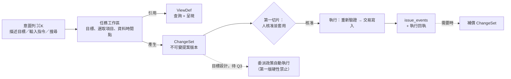
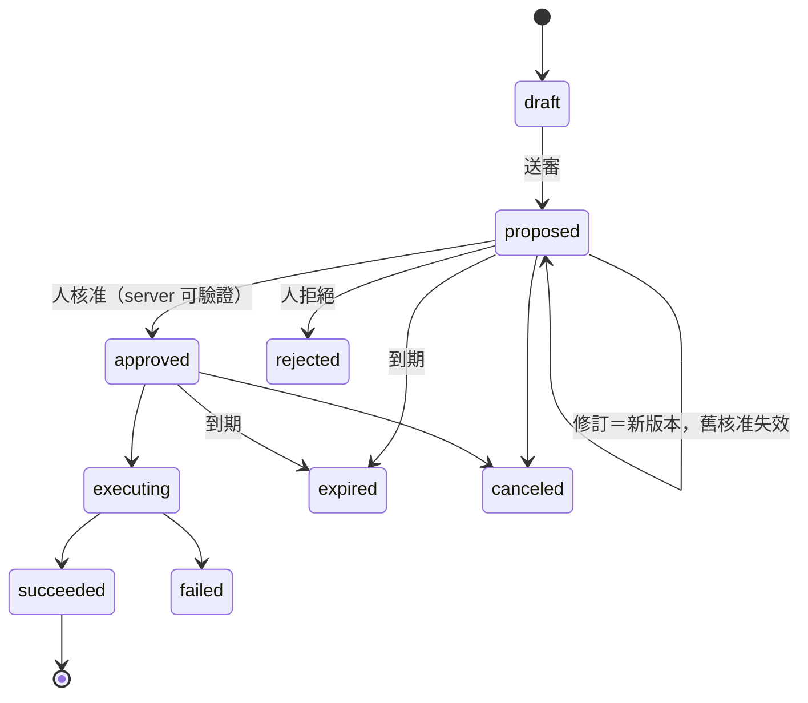
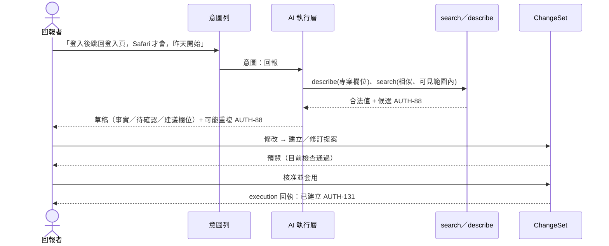
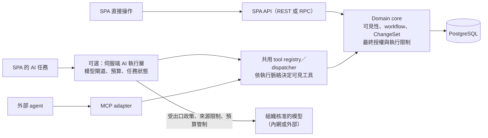

# 設計 01 · oxledger 以 AI 為核心的前端使用流程

- 日期：2026-11-06
- 狀態：設計稿，只談使用流程與所需能力，不含前端程式碼；§13 的問題等使用者決定
- **規範優先序**：本文分「第一切片」和「目標設計」兩種範圍。技術行為以 §15–§16 為準；§5、§6、§14 的情境和示意是流程說明。§13 的產品問題，不會因為流程示意畫了、或技術上做得到，就算定案
- 視覺版：[01-ai-native-ux.html](01-ai-native-ux.html)
- 流程模擬：[01-ai-native-ux-sim.html](01-ai-native-ux-sim.html)（以 AUTH「登入改版 v2.0（支援 SSO）」開發案為例，W0–W6 共 24 步，包含 mindmap、agent 透過 MCP 操控 graph 並截圖、Gantt 順延、BPMN 圖件；可以切換「AI 可用」和「模擬衝突」）
- 前提文件：[../research/01-redmine-rust-rewrite.md](../research/01-redmine-rust-rewrite.md)（D1–D15、§5.2 ViewDef、§5.3 MCP、§5.4 檢索、§8 階段）
- 討論方式：Claude 先寫初稿，和 GPT（gpt-6.1-sol）討論 9 輪（第 5 輪處理追加的多視圖需求，第 6–7 輪把細節收成規格，見 §15；第 8 輪補任務、AI 執行層、ViewDef／session、評估的規格，見 §16；第 9 輪做全文一致性審查並收斂 §13），紀錄在附錄 A

## 0. 一頁摘要

- **建議方向**：③「意圖驅動的任務工作台」當產品目標。使用者從意圖列（⌘K）開始；AI 在中央準備可以操作的工作區（列表、表單、diff），不是只回一段文字；所有 AI 寫入都收斂成 **ChangeSet**，由人審閱、套用。工程上先把 ②「工作台 + AI 側欄」的底座做穩，再長成 ③。
- **三個核心物件，不混在一起**：**ViewDef**（怎麼查、怎麼呈現）、**任務工作區**（這次的目標、選了哪些項目、資料時間點）、**ChangeSet**（要寫入什麼、根據哪個版本、誰核准、結果如何）。
- **AI 原生的意思**：從「想做的事」到「能操作的工作區」距離很短，AI 說的和系統真的做了什麼分得清楚。不是畫面上 AI 文字很多，也不是所有操作都得經過 AI。
- **安全底線**：核心功能不依賴模型。預覽和執行共用同一套領域驗證，執行時重新驗證。撤銷做成「補償提案」，不保證能整組復原。外部 agent 用有範圍的委派政策，不用「信任等級」。
- **後端最大缺口**：M0 只有唯讀的 search／get／resolve。第一個可用切片還缺登入與憑證、SPA API、describe／schema、寫入命令（交易、樂觀鎖、冪等、events）、ChangeSet。
- **多種視圖（2026-11-06 追加，§14）**：mindmap、ontology graph、Gantt、BPMN 分成兩類。**投影視圖**由資料推導，操作分三層：session 呈現、ViewDef 修改、領域變更，只有領域變更會改到 issue、關係或設定。**編寫型圖件**是使用者畫的文件，有自己的版本。MCP 預設提供語意操作（open／state／act／render），不靠像素點擊；會改資料的操作一律產生 ChangeSet。截圖第一版用受控的 headless 渲染頁；「擷取使用者目前的畫面」不開放給無人值守的 agent。BPMN 先做獨立圖件，不承諾和 workflow 通用往返。
- **執行與工作脈絡（§16）**：任務和 AI 執行（run）分開存；AI 執行層有預算、期限、熔斷；提示注入靠 server 端的結構性防線，不靠模型自律；ViewDef 的能力由 server 計算，文件本身不能替自己授權。
- **視覺**：科技感來自精準的資訊層次與回饋。波紋只在三種時機出現，各有固定意思：「正在擷取這個來源」「這個 ChangeSet 實際影響了這些項目」「server 已確認完成」。不當背景裝飾。

## 1. 目標與非目標

**目標**

1. 讓使用者用描述目標的方式開始工作：說「整理本週新的登入問題」，系統就準備好可以操作的分流工作區。
2. AI 能找、能整理、能提案，但每一筆寫入都可以預覽、說得出根據、事後追得到；做不到時會明說。
3. 人、內建 AI、外部 agent（Claude Code、Cursor 等透過 MCP）用同一套可見性、同一套操作語意、同一份 ViewDef。
4. 沒有 AI（模型故障、管理員關閉、隔離網路）時，仍然是一個完整、好用的 issue tracker。

**非目標（這一輪）**

- 不寫前端程式碼，不選 UI 元件庫（只定原則：避開中國來源，見研究文件 D6）。
- 不設計 sprint／容量的正式資料模型（列為待決，§13 Q5）。
- 不做「AI 自動生成任意介面」：AI 只能產生 ViewDef 這類宣告式資料，不產生、也不執行任意 JavaScript。

## 2. 已定前提（摘自研究文件）

| 前提 | 對前端流程的影響 |
|---|---|
| 單一組織（D5） | 沒有「切換 workspace」；首頁就是這個組織 |
| SvelteKit SPA，渲染 server 送來的宣告式 JSON（D6） | AI 產生的畫面也只能是 ViewDef／FormLayout 資料 |
| issue 編號 AUTH-123（D9） | 意圖列輸入 `AUTH-123` 直接開單，不經模型 |
| 可見範圍每請求計算（D10），看不到＝不存在 | AI 摘要、計數、ChangeSet、通知都要套同一套規則 |
| 自訂欄位型別化 EAV（D14） | describe／schema 要能回傳欄位型別與合法值，AI 才不會捏造值 |
| 中文檢索 unigram+bigram + 別名（D15） | 「找相關紀錄」的召回有上限；介面不能把 BM25 說成「理解語意、找齊所有資料」 |
| issue_events 追加為主、actor_kind、lock_version、operation_id（§5.5） | ChangeSet 套用後落成事件；樂觀鎖用來偵測衝突 |
| M0 = 唯讀 search／get／resolve | 所有寫入流程都是目標設計，§10 標出缺口 |

## 3. 使用者

| 使用者 | 核心工作 | AI 該幫的 | 必須留給人的 |
|---|---|---|---|
| PM／產品負責人 | 排優先、規劃版本、追風險、對外說明 | 彙整相關紀錄、找阻擋鏈、準備規劃方案與摘要 | 範圍、優先順序、對外承諾 |
| 開發者 | 理解問題、找歷史脈絡、更新進度、記工時 | 找相關 issue／commit、整理討論、產生更新草稿 | 技術判斷；常用操作不必經過 AI |
| 回報者（含非技術同事、測試、客服） | 把問題說清楚、補證據、看處理結果 | 引導補齊重現步驟、找可能重複、把技術狀態翻成白話 | 確認 AI 沒改掉原意；控制附件與敏感資訊 |
| 分流人員／技術主管 | 分類、指派、排除重複、辨識急件 | 批次提出建議並附理由與疑點 | 快速接受、修改或略過 |
| 管理員 | 欄位、流程、角色、視圖範本 | 從需求產生設定草稿、做影響分析與模擬 | 發布、資料遷移、權限 |
| 外部 AI agent | 在授權範圍內查詢與提案 | 結構化資料、合法值、操作結果 | 由 server 驗證的委派範圍；核准由人做 |
| 稽核／維運（初稿漏掉，GPT 第 2 輪補） | 查「誰核准 AI 改了什麼」、管模型成本與資料出口 | 操作紀錄、用量報表 | 政策設定 |

兩點補充：同一個人會切換角色（開發者也會回報、分流），所以不要做成依角色鎖死的入口。外部 agent 不是管理員的另一個名字：它有自己的身分、委派來源和工具權限。

## 4. 互動原則

### 4.1 三個核心物件



- **ViewDef**：怎麼查詢、怎麼呈現。人和 AI 編同一份，有版本可以 diff（研究文件 §5.2）。
- **任務工作區**：這次要完成什麼、選了哪些 issue、用的是哪個時間點的資料、還有哪些問題沒解決。它不是一條永遠拉不完的對話；但**關閉畫面不代表完成、刪除或取消執行**，任務有自己的生命週期與保留政策（§16.1、§16.7）。
- **ChangeSet**：要寫入的領域命令。它是 DB 裡的一級物件，裡面包含：
  - 不可變的提案版本（改內容＝開新版本，舊的核准自動失效）
  - 核准紀錄（誰核准了哪一版）
  - 執行嘗試和逐項結果
  - 產生的事件，以及補償 ChangeSet 的參照

  ChangeSet 存的是有版本的**領域命令**，不是錄下來的 MCP 呼叫，這樣工具改名或改參數時，舊提案不會跟著壞。

**對話不是第二份 issue 真相。** 對話紀錄、任務狀態、操作稽核三者分開存放，保留政策也分開設（§13 Q2）。

### 4.2 ChangeSet 生命週期



（和 §15.4 同一張圖。第一切片**沒有部分成功**；前置條件變了標成 stale／conflict，要走衝突重新審閱（§15.11），不等於到期。）

- **dry run 不保證能成功**，只代表「在某個資料與權限狀態下當時可行」。apply 時在同一個交易裡，重新檢查權限、workflow、`lock_version` 和前置條件。
- **批次語意要明訂**：第一切片只有 `atomic`（單筆 issue、交易內原子）。逐項成功（`per_item`）是目標設計，還沒開放，收到時回 `unsupported_execution_mode`。不能讓前端自己猜。
- **`operation_id`** 不只用來防重複寫入，也要讓使用者在逾時後查得到結果。
- **人工核准是 server 端的狀態**，不是 MCP 參數 `approved=true`。

### 4.3 依風險分級確認

| 操作 | 確認方式 |
|---|---|
| 搜尋、摘要、暫時調整畫面 | 直接執行 |
| 使用者自己拖曳看板、改單一欄位 | 不加第二次確認畫面：這次明確操作本身就是授權意圖。後端一樣經過共同的驗證、交易、樂觀鎖、冪等和命令紀錄。**不能藉這個手勢套用畫面上沒展示的 AI 額外操作** |
| 存個人 view、AI 提的單筆低風險更新 | 精簡、但完整列出實際變更；由人按「核准並套用」，一樣記錄 approval 和 execution |
| 批次改指派／狀態、發布 note | 完整 diff 預覽 |
| 改可見範圍（公開／私有）、權限、workflow、欄位定義 | 強確認 + 影響報告 |
| 外部通知、資料遷移 | 另外授權或審批，不能用一般對話裡的確認代替 |

**AI 原生不等於強制使用 AI**：熟練的人連改五筆狀態、記工時、貼 note，都不必多按一次「套用」。人工直接操作要不要內部也包成 ChangeSet 是實作選擇，但不能因此出現兩套寫入規則。

**「停止」的範圍**：AI run 可以停止後續的模型與工具呼叫；已經開始的 atomic apply 第一版不支援使用者取消，畫面只查詢結果，不宣稱可以中途停止。

### 4.4 撤銷＝補償提案

不承諾「一鍵整組復原」。按下撤銷時，系統產生一個補償 ChangeSet，逐項標示：

| 標示 | 例子 |
|---|---|
| 可以安全還原 | priority A→B，之後沒人再改過 |
| 需要重新確認 | 之後有人改了同一張單的其他欄位（`lock_version` 不同，但不一定衝突） |
| 已有後續依賴 | 指派後，對方已經寫了處理筆記 |
| 只能更正，不能還原 | 已發布的 note、已記的工時 |
| 無法撤回 | 已寄出的通知、外部整合 |
| 目前權限或流程不允許 | 反向的狀態轉移不合法 |

衝突分三類：**技術衝突**（版本不符）、**領域依賴**（後續流程建立在這個變更上）、**外部副作用**（通知已寄出、別人已經採取行動）。

### 4.5 可解釋

- 說得出用了哪些條件（Filter AST 可以展開）、引用了哪些紀錄（可以指到 note／event 層級）、套用了哪條規則、哪些是推測、缺了哪些資訊、操作為什麼被拒絕。
- **引用只能用工具回傳的來源識別碼**，模型隨手寫出的文字不能變成可點的引用。
- 不顯示模型內部的推理過程。不用一個不透明的「信心 87%」取代根據。

### 4.6 權限一致，衍生結果也算

同一套規則涵蓋 UI、REST、MCP、背景任務和實際寫入。最容易漏的是**衍生內容**：摘要裡一句「另有三筆私人客訴」、facet 計數、關係圖、ChangeSet 的 diff、訂閱信、AI 對話快取，都可能洩露資訊。細節見 §8 D3。

## 5. 情境流程（傳統 vs AI 原生）

每個情境都附上「沒有 AI 時」的退路。各節標出範圍：**〔第一切片〕**已排進第一個可用切片；**〔目標設計〕**是後續能力；**〔待決〕**取決於 §13 的產品問題。

### 5.1 回報問題〔第一切片：文字回報〕

| | 傳統 | AI 原生 |
|---|---|---|
| 起點 | 選專案 → 選 tracker → 開表單 | 在意圖列貼描述（第一切片只收文字；截圖和 log 之後再做） |
| 欄位 | 自己填 | AI 預填，每欄標「AI 建議」並附根據；沒把握的欄位留白 |
| 重複 | 送出後才被別人發現 | 送出前搜尋可見範圍，列出「可能重複」並排比較 |
| 結果 | 直接寫入 | 產生 ChangeSet → 預覽 → 核准並套用 → 建立 issue；或改成補充到既有 issue（`add_note`）；或保存成未套用的提案／任務草稿（不建立 issue，依各自的保留政策處理） |



設計重點：
- 把內容分成「使用者明說的事實」和「待確認」。不能把「昨天開始」寫成「確認是部署造成的回歸」。
- 只追問會影響處理的缺漏，不要求先填完所有欄位。
- 不能把私有內容複製到公開描述。
- 「直接填表」入口一直都在。**沒有 AI 時**：意圖列變成「開新 issue」捷徑 + 純 BM25 找相似單。

### 5.2 分流（triage）〔第一切片：單筆〕

| | 傳統 | AI 原生 |
|---|---|---|
| 介面 | 「未分派」列表，一張一張點開 | 分流工作台：表格，一列一筆，欄位是「建議變更／根據／待確認」 |
| 建議 | 無 | **先套確定性規則**（例如元件對應負責人），規則處理不了的才請模型；建議預設收合 |
| 套用 | 一張一張改 | 第一切片每次審閱並套用一筆；`duplicate_of` 用獨立的關係提案。〔目標設計〕批次套用選取的項目。套用前看完整 diff，套用後看成功／失敗／衝突 |

設計重點：
- 「可能重複」和「關閉為重複」是兩件事。可能重複只是提示，不渲染成正式的 duplicates 標記。
- 不把 AI 提的 priority 預先顯示成正式 priority。標出建議依據的資料版本，資料更新後標成「需重算」。
- 明確顯示「根據不足」，不硬給建議。
- 沒有工作量資料時，不說自己能「最佳化分配」。
- 第一切片只做**單筆**分流。**沒有 AI 時**：同一個表格，建議欄只剩規則結果。

### 5.3 找相關紀錄〔第一切片：直接命中；關係延伸為目標設計〕

| | 傳統 | AI 原生 |
|---|---|---|
| 輸入 | 關鍵字 + 篩選 | 問句：「之前 OAuth callback 在 Safari 失敗，有沒有修過？」 |
| 結果 | 一堆分頁自己比 | 三層：**直接命中**（顯示命中欄位與片段）、**關係延伸**〔目標設計，需要 neighborhood〕（經過哪條 edge 找到）、**附來源的整理結論**，另外列出還無法確認的部分 |
| 保存 | 存查詢 | 可以轉存成 ViewDef〔目標設計〕；一次性的探索不自動存成共用或個人 ViewDef，但暫態 session 和任務紀錄仍依保留政策保存 |

設計重點：查詢摘要可以編輯（AI 把問句解析成什麼條件，攤開給人看）。「沒找到」要說成「在目前可見範圍和這些條件下沒找到」。**沒有 AI 時**：意圖列就是 BM25 搜尋，加上結構化語法。

### 5.4 規劃 sprint〔目標設計；容量與排程待 Q5〕

| | 傳統 | AI 原生 |
|---|---|---|
| 起點 | 篩選 backlog，拖進 sprint | 「下個 sprint 先完成 SSO，留兩成給維運」 |
| 檢查 | 自己心算容量與相依 | 先檢查資料夠不夠（估點、容量、blocks）。不夠就說「只能整理候選範圍」 |
| 呈現 | 看板 | **規劃模式**：看板上方固定橫幅「規劃中，尚未套用」。提案卡用紫色虛線框，並寫明「新增至 sprint／移出 sprint」。正式容量和提案容量分開算。沒估點的卡另外列出，不當成 0 點 |
| 方案 | — | 2–3 個方案分頁比較（例如範圍完整但依賴多／範圍小但風險低），不重疊顯示 |
| 套用 | 拖了就生效 | 在規劃模式拖曳只改草稿，最後收成一個 ChangeSet，套用前重新驗證 |

前提：sprint 的資料模型還沒定（研究文件把 sprint 排在 v2／M3）。在定案之前，這個功能只叫「候選範圍整理」，不宣稱做了容量規劃。**沒有 AI 時**：規劃模式照常可以手動用。

### 5.5 每日站會〔目標設計〕

| | 傳統 | AI 原生 |
|---|---|---|
| 個人 | 回想昨天做了什麼 | 「待確認的站會更新」草稿：上次確認之後的狀態、note、工時、關係變更。「今天預計」由本人填，或沿用上次確認過的計畫 |
| 團隊 | 輪流講 | 團隊畫面只聚焦三件事：**新增阻礙、需要別人決定的事、今天有風險的承諾** |

刻意**不做**依人輪播，也不做自動代人發言（初稿原本這樣寫，第 2 輪被 GPT 指出問題後拿掉）。理由：沒有事件不代表沒有工作；它會把產品推向「每個人都要交代活動量」；本人無法更正。私人筆記不會流進團隊摘要。發布前要檢查聽眾的可見範圍。不用摘要結果去推個人績效。**成本**：先用事件產生確定性的摘要，本人點開時才請模型潤飾。

### 5.6 追進度與風險〔目標設計〕

| | 傳統 | AI 原生 |
|---|---|---|
| 介面 | dashboard 紅黃綠、burndown | 風險工作視圖。每一項都有：**觀察、判定方式（規則或 AI 推論）、證據、未知資訊、建議行動** |
| 行動 | 自己去找人 | 建議行動可以一鍵變成待確認的 ChangeSet（例如請對方更新、調整範圍）；不會直接調高 priority，也不會發通知給整個組織 |

「已逾期」是可以算出來的事實，「可能延誤」是判斷，兩者用不同樣式。顯示資料更新時間。訂閱信在寄出時依收件人重新檢查權限，預設只寄最少資訊加連結。

### 5.7 管理員客製欄位與流程〔目標設計，M2 以後〕

| | 傳統 | AI 原生 |
|---|---|---|
| 輸入 | 逐頁設定欄位、角色、轉移矩陣 | 「Bug 進待驗證前必須有修正版本，只有 QA 能轉成已驗證」 |
| 產出 | 存檔就生效 | 三份東西：**設定草稿**（field_def／field_rules／FormLayout 的 diff）、**影響報告**（現有資料有多少不符合、哪些操作會被擋、影響哪些 view）、**測試案例**（各角色 × 各狀態，允許還是拒絕） |
| 發布 | 直接改 | 先模擬，再發布版本 |

改顯示名稱、改型別或合法值，風險等級不同。改流程不會偷偷搬動既有 issue 的狀態。型別轉換和刪除合法值都要有遷移計畫。ViewDef 的版本不能取代 schema／workflow 自己的版本。**這個情境排在 M2 以後**。

### 5.8 初稿漏掉、GPT 補上的情境

| 情境 | 要怎麼設計 |
|---|---|
| AI 做錯之後的修復 | 只拒絕其中一部分；更正 AI 的理解；中止執行；逾時後查結果；部分成功後接著處理；「這次不要再建議這個」只對自己有效，不自動變成全組織的規則 |
| 多人協作與交接 | 〔目標設計〕PM 提案、主管核准、另一個人執行（第一版只能由最終執行者本人核准）；提案人離職或失去權限；兩個 agent 同時改同一批單；別人接手未完成的分流 |
| 不用 AI 的高頻使用者 | 鍵盤操作、連續改狀態、快速記工時，全程不經 AI |
| 附件、log 與不可信內容 | token、個資、OCR 誤讀、惡意附件、內容裡的提示注入。「AI 讀到這段內容」不代表「這段內容可以指揮 AI」 |
| 模型或 prompt 升級 | 建議品質要做回歸測試（E5 擴充） |

## 6. 首頁與介面骨架

**候選首頁方案**〔待 Q1〕：如果採用決策導向的首頁，以「**需要你介入的決定與例外**」為中心（第 3 輪的建議），平常不需要呼叫模型。示意圖裡的快捷入口和完整收件匣是目標能力，實際顯示哪些由能力開關決定，不支援的不顯示成可按的按鈕：

```
┌──────────────────────────────────────────────────────────────┐
│ ⌘K  搜尋紀錄、輸入指令，或描述你要完成的事……                   │
│     [回報問題] [整理待分流] [找相關紀錄] [規劃 sprint]          │
├──────────────────────────────────────────────────────────────┤
│ 需要你決定                                                    │
│  ◆ 待核准   ChangeSet #41：AUTH-123 指派給 bob（AI 提案）       │
│  ◆ 需要協調 AUTH-118 被 WEB-7 擋住 5 天                        │
│  ◇ 可協助分析 AUTH-127 超過團隊設定的未更新期限 [分析可能阻礙]  │
├──────────────────────────────────────────────────────────────┤
│ 繼續處理：未完成的分流（12/20）、SSO 規劃草稿                     │
├──────────────────────────────────────────────────────────────┤
│ 我的工作：指派給我／我關注／最近的 view                          │
└──────────────────────────────────────────────────────────────┘
```

- 「需要你決定」由規則和事件產生。還沒呼叫模型的項目寫成「可協助分析」，不標成「AI 建議」。
- 同一個原因造成的提醒合併成一則。可以略過、稍後處理、停用規則。原因消失就自動結案。不把「今天沒有待決定的事」當成要補滿的缺陷。
- 工作頁三欄：左邊是導覽和已存的 view；中央是 AI 準備好的工作區（列表、看板、表單、diff）；右邊是任務脈絡，包含證據、建議、待執行的 ChangeSet、執行回執。
- 意圖列：`AUTH-123` 直接開單；結構化語法直接查詢；只有自然語言才送給模型。意圖不清楚時，給 2–4 個明確的路徑讓人選，不要再多問一輪。

## 7. 視覺語言：科技感與波紋

核心語意：**波紋代表看得見的資料流和影響範圍，不代表模型在「思考」，也不代表內容正確。**

| # | 規則 |
|---|---|
| 1 | **色彩各有固定語意**：青（`--accent-action`，例如 #67E8F9）代表可操作、目前焦點；紫（`--accent-proposal`，例如 #C4B5FD）代表還沒套用的提案；綠（#6EE7B7）代表 server 已確認完成；琥珀代表警告，玫瑰紅代表危險。同一個藍色不能同時代表「選取」「AI 建議」「成功」。底色用深海軍藍 #0B1220，淺色主題沿用同一套語意 |
| 2 | **來源讀取波紋**：server 回報開始擷取某個來源時，那張來源卡的外框向外擴一圈 350–500ms，旁邊寫「正在擷取來源」；完成後改成靜態的勾和時間。不可見的來源不顯示節點、外框或數量 |
| 3 | **ChangeSet 影響範圍**：預覽時，受影響的列加細框，關係線短暫強調 150–200ms，標「預計影響」。**收到 server 成功回執之後**，才在實際有寫入事件的項目上播一次 250–350ms 的波紋。部分成功時只標成功的項目 |
| 4 | **等待和有進度要分開**：有階段事件就更新階段名稱。只是在等，就顯示小型進度符號加已等待秒數。不用持續的波紋假裝有進度。等太久時給〔背景執行〕〔取消〕 |
| 5 | **閱讀區禁止持續動畫**：issue 描述、note、diff、列表、權限與管理設定、長時間開著的看板都一樣。科技感靠排版、細框線、等寬數字和資訊層次，不靠整頁粒子 |
| 6 | **規劃模式不只靠透明度**：紫色虛線框加文字標記，再加固定橫幅；拖曳位移 120–180ms，不用大幅彈跳 |
| 7 | **波紋不跨越權限邊界，也不暗示因果**：只有實際產生事件的項目會亮；相關但沒被修改的項目用靜態的「相關」標記 |
| 8 | **無障礙**：遵守 `prefers-reduced-motion`（波紋改成靜態框線加文字）；狀態一律附文字或圖示；鍵盤焦點和 AI 提案的樣式不同；一般文字對比 ≥ 4.5:1；螢幕閱讀器只播報階段變化和完成結果 |

視覺版 HTML 的背景有一個低速、低對比的波紋動畫，只是用來展示整體風格，**不是產品規格**。產品的工作區依規則 5 禁止背景動畫。

## 8. 失敗情境（偵測 → 呈現 → 退路）

| 情境 | 偵測 | 介面呈現 | 系統退路 |
|---|---|---|---|
| **D1 AI 誤判**（分錯專案、把不是重複的標成重複） | schema 驗證抓不到；靠和明確脈絡比對、看有沒有反證、記錄使用者更正與駁回、事後抽樣 | 欄位標「AI 建議」並附依據〔改選〕；可能重複用並排比較〔不是重複〕〔提議建立關係〕 | 任何一欄都能改，不必整份重跑；駁回只對這次有效；已經套用的就產生補償提案；沒確認的 duplicate 不會連帶關單 |
| **D2 幻覺**（引用不存在的 AUTH-999、捏造欄位值或狀態） | 引用必須是這次授權檢索回傳的來源 ID；欄位、狀態、ID 經過 resolve／describe 和領域驗證；dry run 和 apply 各驗一次 | 引用失效時顯示「這個來源目前無法驗證」，不產生看起來正常的卡片；不合法的值旁邊列出合法選項；無法確認的句子放在「待確認」區 | 不合法的操作不能執行；保留合法的部分，重新組成提案再確認；模型重試有次數上限。**不存在和沒權限顯示同一種訊息**，避免被用來探測 |
| **D3 權限洩漏** | 見下表 | | |
| **D4 沒有 AI** | 模型故障：timeout、熔斷；管理員關閉：能力開關；瀏覽器斷線；隔離網路：部署設定 | 模型故障時頂部顯示小條「AI 暫時無法使用；資料與操作正常」；關閉時直接隱藏 AI 動作；斷線時固定顯示「未連線」，快取資料標時間；隔離網路時不反覆跳警告 | 保留輸入和任務；意圖列退化成搜尋加指令；既有 view 照常；**不在背景排隊寫入、重連後也不自動送出**；不預設把私有 issue 長期存在瀏覽器 |
| **D5 成本與延遲** | 開始前估算筆數和輸入量；執行時追蹤 token、工具次數、時間、重試 | 「將分析 180 筆」〔先分析選取的 20 筆〕〔背景分析全部〕；顯示真實階段；知道總數才顯示 20／180；AI run 的取消只停止後續的模型與工具呼叫；已開始的 atomic apply 不提供取消，只顯示「結果確認中」 | 站會先用確定性摘要；增量重算；每個任務、每人、全組織都有預算與併發上限；超額就停止擴展，**不偷偷換成沒核准的供應商**；退回規則結果和原始列表 |
| **D6 不信任／盲目全接受** | 預覽開了就放棄、套用後馬上更正、高影響操作一律全選、同樣的建議一再被駁回（這些只當設計訊號，不做成個人分數） | 寫明「只會改這三個欄位」；一鍵看證據；可以先選擇要保留的項目或欄位，產生修訂版本再核准（**不得執行原核准版本的任意子集**）；顯示能不能補償；高影響項目不預設全選；公開發布、可見範圍、流程設定分開確認；不用倒數或大亮色按鈕催人套用 | 可以按專案或操作類型關閉 AI 建議；純人工操作永遠可用；品質異常時，該類操作降級成只提案；用更正率、完成時間、恢復成本衡量，不追求最大接受率 |

**D3 權限洩漏，分出口處理**

| 出口 | 預防 | 呈現 | 退路 |
|---|---|---|---|
| 摘要與引用 | 模型只拿到這次可見的來源；衍生內容存來源參照與可見範圍 | 來源失去授權時，顯示一般性的「部分內容目前無法顯示」，不露出標題或數量 | 隱藏受影響的摘要，用目前可見的來源重建 |
| facet 計數 | SQL／tantivy 在計數前就套權限（M0 已經如此） | 計數只代表可見資料 | 無法安全計算就不提供，不拿全域快取來頂 |
| ChangeSet | 檢查每一項的目標、前後值和來源權限；核准不會順便授予讀取權 | 看不到的內容不出現在 diff、標題或錯誤細節裡 | 讀不到完整範圍就不能核准，改由合適的人處理或拆開 |
| 訂閱信、通知 | 派送時依收件人重新檢查；不同權限的人不共用同一份摘要 | 預設只寄最少資訊加連結 | 無法安全產生就只寄一般提醒；已寄出的收不回來（文件要寫明） |
| AI 對話與快取 | 快取綁定授權脈絡；讀取時重新檢查 | 遮蔽已失效的片段，tooltip 裡也不留原文 | 重建；找不到來源依據的敏感內容不跨人共用 |
| 提示注入讓 agent 把 private note 寫進公開 note | issue、note、附件一律當不可信資料；身分和核准不能被內容改寫；讀過受限資料後，不允許無人值守發布到更大的受眾 | 顯示「內容使用了受限來源」 | 改存成私人草稿，或走有權限者明確確認的發布流程 |

限制要寫明：**外部 agent 一旦讀到明文，oxledger 無法保證它不在外部外洩。** 所以委派政策要把「可以讀 private」和「可以公開發布」分開，不能同時交給同一個無人值守的 agent。

## 9. AI 放在哪裡

拆成三個問題：誰編排任務、誰發出模型請求、模型在哪裡跑。「server 有模型閘道」不等於「資料一定會離開組織」（可以接內網模型）。



- **核心不依賴模型。** 伺服端 AI 執行層可以關掉；外部 agent 透過 MCP 使用同一套能力。
- **共用 tool registry（Claude 的提案，第 3 輪 GPT 同意並補上限制）**：內建 AI 和 MCP 共用工具 schema 和 dispatcher，前端則直接呼叫 domain core，不用把表格操作包成工具呼叫。代價有四個：
  1. 依執行脈絡給不同的可見工具集合，新工具**預設不對所有入口開放**；`approve_changeset` 這類工具永遠不交給模型。
  2. E5 可以共用測試資產，但內建 AI 和外部 agent 的正確率要分開量。
  3. 工具契約要有版本、穩定的錯誤碼和棄用期。
  4. 查詢工具和執行工具的顆粒度可以不同。
- **BYOK 只是計費和憑證來源的選項，不是隱私架構**；預設由管理員核准供應商和資料出口。

## 10. 後端與 MCP 能力清單（對照 M0）

圖例：✅ M0 已有、📋 研究文件已規劃但還沒做、🆕 這次設計新增。分級是第一個可用切片「回報問題 + 找相關紀錄 + 單筆分流」的需求（第 4 輪收斂）。

| 能力 | 狀態 | 第一切片 | 說明 |
|---|---|---|---|
| `search`（結構化過濾 + BM25、可見性） | ✅ | 必需 | 已有；回報時用草稿組查詢找相似單 |
| `get` | ✅ | 必需 | |
| `resolve` | ✅ | 必需 | 名稱／別名 → id，附合法值 |
| 可見性核心、E4、看不到＝不存在 | ✅ | 必需 | 所有新能力都要經過它 |
| 登入／session、CSRF；agent 用可撤銷、有範圍的憑證 | 🆕 | **阻塞** | OAuth 2.1 可以延後，身分驗證不能延後 |
| SPA API（REST 或 RPC 選一種） | 🆕（研究文件只寫 OpenAPI REST） | **阻塞** | 登入、查詢、schema、ChangeSet 審閱與執行 |
| describe／schema | 🆕 | 必需 | 分兩種：靜態的「專案／tracker 欄位 schema」，和動態的「這個使用者對這張 issue 能做的轉移與動作」（只當提示，apply 時重驗） |
| 領域命令 create_issue／update_fields／transition | 📋 | 必需 | 交易、`lock_version`、冪等鍵綁定 payload、穩定錯誤碼；issue、事件、outbox 同一個交易提交。**agent 的寫入入口只有 `changeset.propose／revise`**，第一版不提供可以直接寫入的 MCP 路徑 |
| `issue_events`（actor_kind） | 📋 | 必需 | 另外記提案者、核准者、實際執行者、委派來源、ChangeSet／operation 參照（只有 actor_kind 不夠） |
| ChangeSet：propose／validate／approve／apply／查結果 | 🆕 | 必需 | 核准綁定版本，執行時重驗；第一版範圍照 §15.1（單一 issue，或建立一張再接著操作；另有獨立的 `duplicate_of` 提案），交易內原子 |
| ChangeSet：compensate（補償提案產生器） | 🆕 | 延後 | |
| search explain（命中欄位與片段、可驗證的引用） | 🆕 | 必需（縮小版） | 別名展開、關係路徑、event 層級引用延後 |
| 共用 tool registry（薄版） | 🆕 | 必需 | 共用契約與 dispatcher、工具允許清單、錯誤碼 |
| 委派政策 | 🆕 | 接外部 agent 時必需 | 第一版：agent 只能提案，不能核准或套用 |
| 提示注入回歸測試、E5 擴充 | 🆕 | 必需（縮小版） | 測非法引用、越權、私有內容被公開 |
| 伺服端 AI 執行層（模型閘道、允許清單、預算、能力開關、任務狀態） | 🆕 | 視路線而定（§12） | 要讓一般使用者驗證 ③，至少要「文字 → 檢索 → 提案」，不含背景執行 |
| `add_note` | 📋 | 必需（§15.1 的支援操作） | 回報時「補充到既有 issue」靠它；要不要放進分流的主要流程可以另外決定 |
| `link`／`unlink` | 📋 | **只開「建立 `duplicate_of`」一種**（§15.10） | 兩端都必須可見、可編輯；不和欄位更新混在同一個 ChangeSet；解除關係和其他關係種類延後；API 和工具的 capability 要分開標 |
| `similar`（獨立工具） | 🆕 | 延後 | 先用 search 組查詢 |
| `events_since` | 🆕 | 延後 | 站會用；「繼續處理」改讀 ChangeSet／任務狀態 |
| 「需要你決定」收件匣（attention items） | 🆕 | 延後 | 第一切片只做「我的待審 ChangeSet」 |
| 建議中的關係 vs 已確認的關係 | 🆕 | 延後 | 第一版把候選關係放在 ChangeSet 裡，確認後才寫進正式 edges，避免 ontology 被污染、也避免兩份真相 |
| `neighborhood`、Filter AST、ViewDef、`list_views`／`save_view`、別名概念擴展 | 📋 | 延後 | 第一切片用固定工作區；M1 固定的 list／board 可以用內部的型別化定義，**可持久化、使用者可編輯的 ViewDef 不是第一切片的前置條件** |
| ViewDef 驗證／預覽／版本 diff | 🆕 | 延後 | |
| 通知派送時依收件人重驗 | 🆕 | 第一切片不寄通知就延後 | 一旦開始寄就是必需 |
| 寫入後的搜尋一致性 | 🆕 | 必需 | 定義索引延遲；剛建立的單還搜不到，不能顯示成建立失敗 |
| 管理設定版本化（草稿、影響分析、模擬、發布） | 🆕 | M2 以後 | 和 ViewDef 的生命週期不同，不共用 |
| sprint／iteration、容量模型 | 📋（M3） | M2 以後 | §13 Q5 |
| `log_time`、OAuth 2.1 | 📋 | M2 以後／延後 | 第三方 client 要求 OAuth 時就變成必需 |

**阻塞順序**：① 登入與 agent 憑證、SPA API、describe、共用授權 → ② create／update／transition 的交易、樂觀鎖、冪等、events → ③ ChangeSet 的提案、核准、原子套用、查結果 → ④ 固定工作台：文字回報、相關搜尋、單筆 diff 審閱、衝突與失敗畫面 → ⑤ MCP 提案工具，加上越權、注入、逾時重試、搜尋延遲的測試。

## 11. 風險

1. **分不清「AI 說的」和「系統真的做了」**：信任和資料品質一起壞掉。對策：建議有標示、寫入有預覽、結果有回執、部分成功不被摘要蓋過。
2. **衍生資訊洩漏**：摘要、計數、通知、快取（§8 D3）。這和研究文件風險 1「權限語意不一致」是同一級，要寫進 E4 的延伸測試。
3. **摘要把還沒定的討論寫成共識**：要分清提案、決議、被推翻的決議，並引用時間與來源。
4. **ontology 被 AI 的推測污染**：AI 提的關係在確認前不寫進正式 edges。
5. **批次操作其實不可恢復**：重試時不能重複加 note、重複記工時，冪等和逐項狀態要先設計好。
6. **權限變了，舊任務還能執行**：核准和執行時都要重新驗證。
7. **AI 讓熟手變慢**：直接操作、快捷鍵、批次操作一直都要在。
8. **太早做成泛用 UI 生成平台**：ViewDef 先只支援常用元件，不讓它擋住寫入閉環。
9. **成本、延遲、供應商故障**：AI 不能成為 tracker 的單點依賴。

## 12. 可選的整體方向

| 維度 | ① 對話優先 | ② 工作台優先 + AI 側欄 | ③ 意圖驅動的任務工作台 |
|---|---|---|---|
| 一句話 | 主畫面是對話，列表和表單是訊息裡的卡片 | 使用者先打開列表、看板或 issue，AI 協助目前位置 | 使用者先描述任務，AI 準備跨 view 的工作區，最後收斂成 ChangeSet |
| 學習成本 | 開始容易，但要學會穩定拿到好結果反而難 | 熟悉 tracker 的人很低 | 中：要理解「任務／草稿／正式資料」的差別 |
| 高頻操作效率 | 低（大量掃描、比較、逐欄修改） | **最高** | 高，前提是保留直接操作 |
| AI 差異化 | 高，但容易停在「對話形式」 | 中，容易退化成旁邊多一個聊天框 | **高**：準備工作區、組合多步操作 |
| 對照 M0 的實作成本與風險 | 問答展示容易；可靠的任務狀態、引用和寫入是中高 | **最低**，可以疊在唯讀 view 上 | 最高：任務狀態、工作區組合、ChangeSet、恢復機制 |
| 沒有 AI 時的品質 | **最差** | **最好** | 良好（前提是工作區、查詢、操作都不依賴模型） |
| 外部 agent 協作一致性 | 工具一致，對話歷史不一致 | 工具一致，agent 的提案不容易自然出現在畫面上 | **最好**，前提是任務產物和 ChangeSet 是共用的一級物件 |

**建議（不替使用者決定）**：產品目標選 ③，實作路線先做 ② 的可靠底座。① 可以當作特定模式（例如回報者的簡化入口），不建議當唯一的主介面。

**第一切片的 AI 來源**，有兩條路：

| 路線 | 能證明什麼 | 風險 |
|---|---|---|
| 外部 agent 是唯一的 AI 來源（agent 透過 MCP 準備 ChangeSet，人在 SPA 審閱、套用） | 完整的安全閉環；不必先做模型閘道 | 非技術的回報者用不了；⌘K 還不能完成 AI 任務。只能叫「agent 協作切片」，不能說已驗證 AI 原生前端 |
| 最小伺服端 AI 執行層（只做「文字 → 檢索 → 提案」，不背景執行、不自動套用） | 能讓一般使用者驗證 ③ 的主要體驗 | 多了資料出口、金鑰、成本、timeout、提示注入的處理 |

建議的工程順序：先做外部 agent → ChangeSet → SPA 人工套用的閉環，不讓模型閘道擋住寫入的基礎；要請一般使用者評估 ③ 之前，再補上最小的內建入口。

## 13. 待使用者決定

> **2026-11-06 使用者已決定**（以下表格保留原始選項供追溯）：
> - **Q1**：產品目標選 ③ 意圖驅動的任務工作台，工程先做 ② 工作台 + AI 側欄的底座；① 只當回報者的簡化入口。首批使用者與首頁配置沿用建議預設（回報 + 單筆分流；§6 候選配置），之後可再調。
> - **Q6**：先做外部 agent → MCP 提案（ChangeSet）→ SPA 人工套用的閉環；給一般使用者試用前，再補最小內建入口。
> - **Q13**：「不用中國產品」看開發者或公司所在地；範圍是直接依賴、模型、詞典、字型、託管服務。間接依賴只列清單，不硬擋。
> - 其餘各題暫依下方「建議預設」，Q2、Q4 維持關閉。

第 9 輪把 Q1–Q13 對照 §15–§16 收斂過一次。**沒有任何一題已經被技術規格完整決定**，但有些子問題已經有固定限制，這裡把「已定的部分」和「仍待決的部分」分開寫。

| # | 問題 | 已定的部分（技術限制或既有預設） | 仍待使用者決定 |
|---|---|---|---|
| Q1 | **方向、首批使用者、首頁配置**（三個子決策） | — | 選 ①②③；第一版先服務誰；首頁是否採用 §6 的決策導向配置 |
| Q2 | **模型與資料出口**，以及對話／模型日誌的保留 | 預設停用出口；BYOK 不能繞過組織政策；不預設永久保存原始 prompt | 允不允許外部模型、哪些來源可以送出、日誌留多久 |
| Q3 | **無人值守寫入** | ~~第一版固定：零自動套用~~〔D20（2026-11-07）改為：依委派政策直接寫入，預設 direct，見設計 02 §16〕 | 之後要不要開放、開放到哪些操作 |
| Q4 | **受限資料轉成給更多人看的內容** | server 一律檢查受眾，**不會自動降級**（§16.4） | 人工發布的政策：誰能批准、要什麼確認、訂閱信能帶多少內容 |
| Q5 | **sprint 要不要做成正式的領域模型** | 定案前只做「候選範圍整理」；選了 sprint 也不會自動有工作日曆和排程依賴 | 要不要承諾容量與排程能力 |
| Q6 | **第一切片的 AI 來源** | 受 Q2 約束 | 只靠外部 agent，還是同時做最小內建入口 |
| Q7 | **視覺主題** | 波紋的三種語意、reduced-motion、對比要求已定（§7） | 預設深色還是淺色 |
| Q8 | **BPMN 的交付範圍** | BPMN 和 workflow 模型分離、不承諾通用往返（§14.2） | 三種能力（獨立圖件、workflow 編輯器、受限匯入匯出）要哪些、先後順序 |
| Q9 | **截圖的部署限制**（已從產品問卷改成部署確認） | 技術預設：受控 headless、可以停用，停用時 `view.state` 照常（§14.4） | 部署上能不能多一個瀏覽器程序；有禁止的話改成停用 render |
| Q10 | **MCP 讀取與匯出能力預設對誰開** | 語意操作、不提供擷取使用者畫面、資料變更第一版只能提案；**工具存在不等於授權** | 哪些讀取、匯出能力預設對哪些主體開；render 是否受模型出口政策管 |
| Q11 | **視圖的優先順序** | — | mindmap、ontology graph、BPMN、Gantt 的先後（§14.8 只是工程建議） |
| Q12 | **提醒的組織政策** | 提醒的機制已定（§15.11） | 哪些是個人可以關掉的輔助、哪些是組織要求的必辦 |
| Q13 | **「避免中國來源」的判定範圍** | — | 看治理、維護者、供應鏈還是其他？包不包含間接依賴、字型、模型、託管服務？ |

**相依關係**：

```text
Q13 來源判定 ─→ Q2 可用的模型／供應商候選
            └→ Q9 renderer 元件候選與部署方式
Q1 方向＋首批使用者 ─→ Q6 AI 來源、Q11 視圖優先序、Q12 提醒定位
Q2 資料出口 ─→ Q6 AI 來源、Q10 render／讀取的啟用政策
Q4 受限資料發布 ─→ Q3 後續自動化、Q10 匯出與分享的邊界
Q8 BPMN 範圍 ＋ Q5 排程模型 ＋ Q9 部署限制 ─→ Q11 可行的排程
Q7 主題：大致獨立，不阻塞核心後端
```

**建議的決定順序**：① Q13、Q2、Q4（供應鏈、資料、發布的邊界）→ ② Q1 → ③ Q6、Q10、Q9 部署確認（決定第一切片實際開哪些能力）→ ④ Q5、Q8、Q11 → ⑤ Q12、Q7；Q3 的後續開放另外當成里程碑決策。

**一套互相一致的建議預設**（只供選擇，不代表定案）：

| # | 建議預設 | 一定要使用者明確決定嗎 |
|---|---|---|
| Q1 | 目標 ③、工程先 ②；首批是回報 + 單筆分流；首頁採 §6 的候選配置 | **是**：產品價值和對象沒有安全的技術預設 |
| Q2 | 核准前停用模型出口；核准後用管理員指定的端點，不允許 BYOK 繞過政策 | **要開放出口時一定要確認**；不回答＝維持停用 |
| Q3 | 第一版零自動套用；之後只開明確白名單 | 初期不必選；要擴大時才確認 |
| Q4 | 不自動擴大受眾；人工發布需要權限、來源提示和明確確認 | **要開放降級發布時，必須指定政策和責任人**；不回答＝不開放 |
| Q5 | 選定正式模型前只做候選範圍整理，不承諾容量或自動順延 | 要承諾規劃能力時才確認 |
| Q6 | 工程先做外部 agent 閉環；一般使用者測試前補最小內建入口（受 Q2 約束） | **是**：取決於第一批要驗證什麼 |
| Q7 | 深色預設、提供淺色 | 可以採預設 |
| Q8 | 先做獨立 BPMN 圖件；workflow 編輯器和受限往返另外排 | 可以採預設；BPMN 很急的話要說 |
| Q9 | 受控 headless、可以停用 | 部署有限制時要提出 |
| Q10 | 明確委派範圍內開讀取和純呈現；render 需要匯出能力並受出口政策管；不提供擷取使用者畫面 | 「預設支援」不能解讀成全面匯出授權 |
| Q11 | ~~parent mindmap／ontology → BPMN 圖件 → Gantt~~ | **被 00 U27 推翻（2026-11-07）**：list／board／triage → roadmap＋健康度 → Gantt → mindmap → BPMN；ontology 保留為分析視圖 |
| Q12 | 全部是個人可以停用的輔助提醒 | 可以採預設；要做必辦制度另外確認 |
| Q13 | 定義之前，候選一律不標成合規，也不下載或採用新的候選 | **是**：目前沒有可以操作的判定標準 |

安全類問題的通則：**有安全的「拒絕／停用」預設，沒有安全的「允許」預設。** 所以 Q2、Q4 不回答不會擋住開發，只是對應的出口或發布能力不開。

## 14. 多種視圖、MCP 操控與截圖（2026-11-06 追加）

使用者的追加需求：「需要支援 mindmap、ontology graph、gantt、bpmn 等，MCP 也要 default 支援操控與截圖」。Claude 先寫初稿，再請 GPT 做第 5 輪批判（附錄 A），以下是收斂後的版本。

### 14.1 兩類視圖

| 類別 | 定義 | 包含 | 改它會改到什麼 |
|---|---|---|---|
| **投影視圖** | 從資料推導出來，ViewDef 描述怎麼查、怎麼畫 | list、board、calendar、**Gantt**（開始日／到期日 + 排程依賴）、**mindmap**（依 parent 樹或指定關係展開）、**ontology graph**（issue 關係、concept 關係、issue–concept 關聯的局部鄰域）、**workflow 圖**（tracker × role 的狀態轉移） | issue、關係或設定，一律走 ChangeSet；workflow 走管理設定的發布流程（§5.7） |
| **編寫型圖件** | 使用者畫的文件，有自己的版本和權限 | **BPMN 流程圖**、自由心智圖 | 只改圖件本身；節點可以連到 `AUTH-123` 或 concept，但圖件不是 issue 的真相 |

同一個手勢可能落在三個層次，介面要用明確的模式區分，不讓元件或 AI 去猜：

| 層次 | 改到哪裡 | 例子 |
|---|---|---|
| 呈現操作 | view session | 縮放、收合、拖動節點位置 |
| 視圖定義 | ViewDef | 改分組、關係種類、根節點 |
| 領域操作 | issue、關係、設定 | 拖 Gantt 的 bar 改日期、在 mindmap 拖節點改 parent、在 graph 上連線建立 blocks |

**每種視圖的能力要明確**：可以檢視、可以調整呈現、可以編輯定義、可以提議資料變更、可以匯出。不能只靠 `kind=graph` 推導出它能做什麼。renderer 登錄自己支援的能力；**server 再依授權和部署設定算出 `effective_capabilities`**，ViewDef 文件只能寫 `requested_features`，不能替自己授權（§16.5）。新增一種視圖時，都要寫清楚：能看什麼、能改什麼、改到哪個真相來源、怎麼授權、失敗時怎麼處理。

ViewDef 擴充（草案）：`kind` 增加 `gantt | mindmap | graph | workflow`。各 kind 有專屬映射：

- gantt：`start_field`、`due_field`、`dep_rels`、`calendar`
- graph：`node_types`、`rels`、`depth`、`max_nodes`、`max_edges`
- mindmap：`root`、`child_rel`、`cross_links`

所有 kind 共用同一份 Filter AST 和同一套可見性。

### 14.2 BPMN 的定位

BPMN 描述的是活動、事件和 token 的流動；oxledger 的 workflow 描述的是一筆紀錄可以處在哪些狀態、誰可以做哪些轉移。**兩者不是同一個模型。** 所以拆成三個不同的能力：

1. **BPMN 獨立圖件**：描述業務流程，節點可以連到 issue 或 concept。
2. **oxledger workflow 圖形編輯器**：精確編輯狀態、轉移、權限、欄位規則（可以借用類似 BPMN 的外觀，但不宣稱支援 BPMN）。
3. **受限的 BPMN ↔ workflow 匯入匯出**（後期，另外決定）：只保證「oxledger 自己匯出的受限 BPMN，加上擴充 metadata，在允許的修改範圍內可以重新匯入」。

| BPMN 元素 | 映射到 workflow | 失真的地方 |
|---|---|---|
| 單一路徑、互斥分支 | 可以定義受限映射 | task 不天然等於「狀態」，要明訂對應方式 |
| 起點、終點 | 部分可以 | issue 可以重開、有多個終態 |
| 條件式流向 | 用擴充欄位存 | BPMN 條件式 ≠ Filter AST 或欄位規則 |
| lane | 只能當「建議負責角色」 | **lane 是分工，不是授權** |
| 欄位必填、可編輯、private | 原生 BPMN 沒有 | 只能存在擴充裡，外部編輯器不一定看得懂 |
| 平行 gateway、join | 不映射 | 一筆 issue 同時只有一個狀態 |
| message／timer／boundary event、補償、子流程 | 不映射 | 需要流程執行引擎 |

匯入時遇到不支援的元素，要產生診斷報告，或保留成獨立圖件。**不能默默丟掉語意後就發布。** 從 BPMN 發布 workflow 一律走管理設定的影響分析、模擬、發布流程。

### 14.3 MCP 操控：語意操作，不是像素點擊

| 工具 | 作用 | 建議能力設定（待 Q10 決定；第一切片的硬限制見 §15） |
|---|---|---|
| `view.kinds` | 回報支援哪些 kind、操作、輸出格式和上限（能力協商；不支援的就不假裝成功） | 開 |
| `view.open(view_def \| kind+query)` | 建立 view session，回傳 `session_id`、`session_revision` | 開 |
| `view.state(session, scope)` | **語意摘要優先**：kind、條件、可見範圍摘要、選取項、截斷原因、下一步選項；明細依選取、時間窗、群組或局部鄰域分頁讀取；座標要另外指定才回傳 | 開 |
| `view.act(session, ops, expected_revision)` | 呈現操作只影響這個 session；會改 ViewDef 的回傳 ViewDef diff；會改資料的回傳 **ChangeSet 提案**。**一次請求只接受同一類操作**，混合類別直接拒絕；呈現操作不會持久化成領域變更 | 呈現操作開；其他只能提案 |
| `view.render(session, format, viewport)` | 產生乾淨的圖像（PNG 為主；SVG 會移除 script 和外部資源） | 開，但有上限並記稽核 |
| `diagram.get／propose_edit` | 讀取圖件；提出圖件修改（穩定節點 ID、版本衝突檢查） | 讀開；改只能提案 |
| 擷取使用者目前畫面 | 包含側欄、未儲存內容、浮動層的像素 | **不提供給無人值守的 agent**；只在使用者主動發起時使用 |

**view session 和任務工作區不一樣。** session 是一次開啟的視圖實例，包含焦點、收合、縮放、選取。一個任務工作區可以同時有好幾個 session（例如 Gantt + mindmap + 列表）。第一版 session 存在 server，原則如下（TTL、容量等數值以 §16.6 為準）：

- 有 TTL、擁有者和委派來源。
- 只存引用和呈現狀態，不存授權資料的快照。
- 每次呼叫 `state`、`act`、`render` 都重新授權。
- **知道 session ID 不等於有權限讀取。**
- agent 預設操作自己的 session，不去動使用者畫面上的縮放和選取。要共用畫面控制時，顯示「Agent 正在協助操作此視圖〔暫停控制〕」。

### 14.4 截圖架構

| 方案 | 優點 | 問題 | 判斷 |
|---|---|---|---|
| (a) 受控的 headless 瀏覽器跑 render 專用頁 | 和前端共用元件、字型、版面，最容易支援多種圖 | 自架部署多一個瀏覽器程序；要管記憶體、隔離、「渲染完成」的判定 | **第一版建議**，可以關閉（Q9） |
| (b) 每種 kind 用 Rust 寫一套 SVG renderer | 輕、可控 | 呈現邏輯會有兩份 | 不當通用方案 |
| (c) Rust 算版面座標，前後端共用 | 簡單的圖有機會共用幾何結果 | 中文字型量測、換行、時區、edge routing、BPMN 幾何、光柵器差異，工程量遠超過「把 JSON 序列化」 | 只對成熟、受限的圖型再評估 |

（Claude 初稿原本傾向 (c)，第 5 輪被 GPT 說服改成 (a)。Claude 保留的顧慮是：單一組織自架時，多一個 headless 瀏覽器會增加維運和映像檔大小，所以列成 Q9 給使用者決定。）

(a) 的限制：
- 只跑固定、沒有導覽列的 render 頁，不接受 agent 傳入任意 URL。
- 用短效、受限的 render context 讀資料；禁止外部 script、字型、圖片。
- CPU、記憶體、時間、網路都有上限。
- 等明確的 `render_ready` 訊號才截圖，並關掉動畫，不靠固定等待秒數。
- 圖上標示資料時間、ViewDef 或圖件版本、session revision。

### 14.5 權限與資料出口

- **先過濾可見性，再計算版面、degree、排名、分群和聚合。** 看不到的節點不畫；連到它的邊整條拿掉；不顯示「還有 3 個隱藏鄰居」；不留下座標空洞；錯誤訊息不透露「因為一個你看不到的依賴而失敗」。
- 關係本身的存在、concept、label、關係型別，都可能是受限資訊。
- 圖件和它連結的目標各有權限：看得到圖件，不代表看得到連結 issue 的標題。把 private issue 的標題複製成自由節點文字之後，目標 issue 的 ACL 就保護不到它了，所以複製要經過檢查。
- **截圖屬於資料匯出**，處理原則：
  - 記錄呼叫者、範圍、版本。
  - 圖片和原始資料適用同一套模型出口政策；變成像素不等於去識別化。
  - 浮水印（組織、時間、匯出者、追蹤 ID）只用來追溯，不能防止洩漏。
  - 圖片的 resource URL 每次讀取都重新驗證，不做公開或永久的連結。
  - 截圖不能自動變成可以對外發布的附件。
- **防 DoS**：限制節點數、邊數、輸出像素、檔案大小、渲染時間、併發數和每日額度。預設只渲染目前視窗，全圖匯出是額外的工作。
- 「預設支援」的意思是**工具預設存在**，不代表授權、資料出口和資源上限也預設無限制（Q10）。

### 14.6 大圖

- 不把整張圖縮小交出去，而是分層探索：graph 限制深度、節點數、邊數，一區一區展開；Gantt 依日期窗和列範圍查詢，epic 可以收合。
- 回應一定要附上 `truncated`、`reason`、`coverage`（例如「這個根節點的局部鄰域，不是完整關係圖」）、`next_actions`。**「結果裡沒有」不能被解讀成「不存在」。**
- 聚合節點要標明是群組；所有計數只算可見集合。分頁游標綁定查詢條件和資料版本，資料版本變了就明確失效。
- 先給模型語意摘要，需要視覺判斷時才 render，不要同時塞進完整 JSON 和圖片。

### 14.7 AI 原生的互動與陷阱

| 意圖 | 做法 | 陷阱 |
|---|---|---|
| 「把 AUTH-145 延後一週並順延相依」 | **確定性的排程計算器**算出連鎖影響，不讓 LLM 自己算。預覽時原日期用淡色輪廓、提案日期用紫色 bar，受影響的依賴鏈強調並逐項 diff，列出計算規則、固定約束、未解決的問題 | blocks 不一定是排程依賴；「一週」是日曆天還是工作天；已完成、固定日期、跨專案的項目能不能動；循環依賴、缺日期。**有工作日曆和依賴模型之前，只做「日期移動預覽」，不叫它自動排程**；不可見的項目不動，也不透露它存在 |
| 「把 SSO epic 畫成 mindmap」 | 先分清三種節點：正式節點（已存在的 issue）、推導群組（只為了好讀，不是新的 parent 或 concept）、建議節點（還沒建立） | 不能為了畫成樹而默默改 parent；多父、環、交叉邊要用參照節點或截斷標示，不能直接丟掉 |
| 「從 BPMN 草圖產生 issue」 | 先確認要產生的是一次性工作清單、工作範本，還是流程導入計畫；提案時列出哪些活動要產生 issue、lane 怎麼建議負責人（不授權）、sequence flow 怎麼映射（預設不全部變成 blocks） | BPMN task 不一定是 issue（可能是反覆執行的活動、自動化服務、gateway、事件）；重跑時要能認出已經建立的項目，不能只靠 operation_id 防止語意上的重複 |

### 14.8 階段排序

| 階段 | 交付 | 不承諾 |
|---|---|---|
| M1 | list／board 加寫入閉環；薄版的 `view.open／state／act`；受控的 list／board render | 任意圖型；擷取使用者畫面 |
| M1 後續 | parent mindmap、唯讀 ontology 局部鄰域；共用節點 ID、上限與截斷契約 | 自由畫圖；AI 自動寫入 ontology |
| M2 | 自由 mindmap 圖件、圖件版本與連結權限；BPMN 圖件的檢視與編寫 | 從 BPMN 發布 workflow；流程執行 |
| M3 | Gantt：先唯讀，再單筆改日期 + ChangeSet 預覽；dashboard | 沒有排程模型就宣稱自動順延 |
| M3 後續 | 依賴、工作日曆、約束都定好之後的連鎖排程；workflow 圖形編輯器 | 任意 BPMN 無損轉換 |
| 另外決定 | 受限的 BPMN ↔ workflow 映射、發布、遷移 | 把 BPMN 執行引擎當附帶功能 |

如果 BPMN 是最急的需求，可以把「BPMN 獨立圖件」提前，但不連帶提前 workflow 往返。

### 14.9 前端元件候選（未查證、未下載）

| 用途 | 候選 | 待查 |
|---|---|---|
| Gantt | frappe-gantt | 實際版本的授權、大量列的效能 |
| graph 與版面 | Cytoscape.js、dagre、elkjs | elkjs 是 EPL-2.0，和 GPL-2.0-or-later 的組合方式要查 |
| BPMN | bpmn-js（bpmn.io） | 自訂授權要求保留 logo 浮水印，和 GPL 的相容性要查；就算選了它，也不代表 BPMN 語意驗證或安全匯入已經完成 |
| mindmap | 用 graph 引擎的樹狀版面自製 | markmap 的來源要先查證再決定 |
| 避開 | AntV（G6、X6）、ECharts | 中國來源 |

授權、notice 要求、散布方式要依**實際版本**查證。作者、維護者、依賴鏈是不同的問題，不能只看作者名字推定來源。這次沒有下載或安裝任何東西。

### 14.10 後端能力（併入 §10 的分級）

| 能力 | 狀態 | 階段 |
|---|---|---|
| ViewDef 的 kind 擴充、`effective_capabilities` | 🆕 | M1 的 list／board 先用內部型別化定義；使用者可編輯的 ViewDef 和其他 kind 依 §14.8 |
| view session（TTL、revision、重新授權） | 🆕 | M1 |
| `view.kinds／open／state／act` | 🆕 | M1 薄版 |
| `view.render` + 受控 render 頁 + 上限 + 稽核 | 🆕 | M1（list／board） |
| 圖件儲存：穩定節點 ID、版本、併發、連結權限、匯入安全（BPMN XML、SVG） | 🆕 | M2 |
| 確定性排程計算器（依賴型態、工作日曆、約束） | 🆕 | M3 |
| workflow 圖形編輯器、BPMN 映射的診斷報告 | 🆕 | M3 後續、另外決定 |
| 截圖契約測試（不多畫資料、可見性一致、中文正常、輸出不超限） | 🆕 | 跟著 render 一起做 |

## 15. 規格細節（第 6–7 輪收斂）

使用者指示：「各session如果有細節問題，跟gpt多輪討論後執行」。這一節把前面留著沒定的技術與互動細節收成可以實作、可以測試的規格。產品方向不在這裡決定，仍列在 §13。

### 15.1 第一切片的不變條件

| 項目 | 規格 |
|---|---|
| 執行模式 | 只有 `atomic`；收到 `per_item` 回 `unsupported_execution_mode`，不偷偷降級 |
| 目標範圍 | 每個版本只能動一張既有 issue，或建立一張新 issue 並在同一個交易裡接著操作它。**另外允許單一的 `duplicate_of` 關係操作**（兩端都是既有 issue），但不和欄位更新混在同一個 ChangeSet，也不連帶關單 |
| 操作種類 | create／update_fields／transition／add_note，加上 duplicate_of；其他種類回 `unsupported_operation` |
| 核准與執行 | 只有已登入的人可以做；agent 和內建模型都不行。第一版核准者就是執行者本人 |
| 唯一套用 | **同一個提案版本最多成功套用一次**；成功之後不能再修訂或重跑，要改就另建 ChangeSet |
| 歷史 | 提案版本、核准決定、執行結果都不可原地改寫；`state` 欄位只是目前狀態的索引 |

### 15.2 資料模型

| 表 | 重點 |
|---|---|
| `changesets` | `context_project_id`（只用來分類，**不是授權邊界**）、`origin`、`proposer_principal_id`、`on_behalf_of_user_id`、`delegation_id?`、`authority_grant_id?`、`task_id?`、`current_version`、`state`。`origin` 和提案者由 server 依呼叫入口推導，客戶端不能指定 |
| `changeset_versions` | PK `(changeset_id, version)`，不可變。內容：title、ops、target_preconditions、evidence、exec_mode、expires_at、`proposal_hash`、command_schema_version |
| `changeset_approvals` | append-only；綁定 `version + proposal_hash` |
| `changeset_executions` | `attempt_no` 只用來追蹤，**不是冪等鍵**；另有 executor、approval_id、status、item_results，以及崩潰復原用的 lease／fencing 欄位 |
| `operation_requests` | `(caller_principal_id, operation_id)` 唯一，存請求內容的 fingerprint；同一個 key 配不同內容就拒絕 |
| `changeset_applications` | PK `(changeset_id, version)`，**和領域寫入在同一個交易建立**，用資料庫保證不會重複套用 |
| `changeset_compensation_refs` | 補償版本的 op → 原 execution 的 op（不只記原 ChangeSet ID） |

`changeset_versions` 另外保存不可變的 **`proposal_authority_ceiling`**（提案當時的授權上限，或等價的版本化參照）。apply 時要同時符合「原上限」和「目前有效授權」，委派之後放寬也不能擴大舊提案。

`proposal_hash` 用 server 定義的標準序列化計算，涵蓋 ops 和順序、前置條件、執行模式、期限、核准畫面上的 title／evidence、授權來源、命令 schema 版本。**核准之後只改 title 或 evidence，也不能沿用原本的核准。** 不保存原始的 access token。

### 15.3 操作格式與暫時引用

- 目標要明確寫型別：`{"type":"issue","id":…}` 或 `{"type":"temp","ref":"new1"}`。issue key 在提案存檔前就解析成不可變 ID，key 只拿來顯示。
- 只有 create op 可以 `bind` 暫時名稱，名稱不可重複；只能引用前面 op 宣告的名稱；未宣告的引用、循環引用、重複宣告，都會讓整份提案被拒絕。
- 前置條件同時檢查 `lock_version` 和 `field_values`，不會因為欄位值相同就放寬版本衝突。
- 同一個 issue 的多個 op：交易開始時檢查一次初始版本，之後依序執行，後一個 op 看得到前一個的結果。整個 ChangeSet 對該 issue 只把 `lock_version` 加一次。
- 實際上沒有改變任何東西的操作回 `no_effect`，不產生假事件，也不增加版本。**所有 op 都是 no_effect 時**，這次執行仍記為成功並建立 application（避免同一版本被反覆執行），但不產生 issue 變更事件、不增加 `lock_version`。
- `validate` 要模擬依序執行的效果（例如先轉狀態再加 note，加 note 要依新狀態判斷合不合法）。

### 15.4 狀態與期限

```
draft → proposed → approved → executing → succeeded
           └→ rejected               └→ failed
未執行前 → canceled / expired
```

- `revise` 必須帶 `expected_current_version`。只能在沒有正在執行、也沒有成功套用的時候修訂；修訂後回到 proposed，舊核准保留在歷史裡，但不能授權新版本。
- failed 之後要重試，條件是：確定沒有提交任何效果、版本沒變、核准和權限仍然有效，並且使用**新的** operation_id。
- 預設期限 7 天，上限受組織設定和委派到期時間限制；修訂**不會**延長期限。proposed 和 approved 都受期限限制，在取得鎖、開始寫入之前用 server 時鐘檢查；背景清理 job 只負責整理狀態，不是安全邊界。

### 15.5 冪等、交易與崩潰

| 識別碼 | 意義 |
|---|---|
| `operation_id` | 客戶端對同一次請求固定使用的 key |
| `execution_id` | server 建立的執行識別 |
| `attempt_no` | server 對真正的新嘗試編號 |

| 情境 | 規格 |
|---|---|
| 同一個 key、同樣內容 | 回傳同一個 execution 或結果；還在執行就回「執行中」 |
| 同一個 key、不同內容 | `idempotency_key_reused`，不執行 |
| 新的 key，但這個版本已經成功 | 回 `already_applied` 或既有結果，不再寫入 |
| 客戶端逾時 | 不代表失敗；用原本的 operation_id 查詢或重送 |
| **結果不明** | 已送出 COMMIT 後連線中斷或程序崩潰、worker 失聯。**先查原 execution 和 application，不開新的 attempt** |
| deadlock 或 serialization failure | 確認交易已 rollback 後有限次重試，沿用同一個 execution |

執行時，以下這些在**同一個交易**裡提交：領域資料、issue_events、必要的 outbox、application 紀錄、execution 的成功狀態。atomic 失敗時，逐項結果標成 `rolled_back` 或 `not_executed`，不顯示「前幾項成功」。舊 worker 被接手後不能再提交（fencing）。

### 15.6 執行資格與委派

以下條件**全部成立**才能執行，不是把三個集合取交集就好：

1. 執行者目前有權限（人工核准不會給執行者本來沒有的權限）。
2. 目前版本有有效的核准，`proposal_hash` 一致。
3. 原始提案的授權來源（delegation／grant）沒有被撤銷、也沒到期。
4. 操作在提案者原本的授權上限之內：**人按下套用，不會把 agent 的提案範圍放大**；要超出就另建人類的提案。
5. 委派者目前仍有權限（離職、停權、降權都會生效）。
6. 每一項的 issue、private note、欄位、workflow 權限都通過。

委派欄位：`agent_principal_id`（執行身分）和 `agent_client_id`（軟體）分開記；範圍（專案、操作、欄位、批量、期限）；`read_private_issues`、`read_private_notes` 拆開，**這兩個都只是額外限制，不會額外授權**；第一版 agent 不能公開發布；`auto_apply_ops` 第一版必須是空的，server 硬性拒絕。approve／apply 的 API handler 要**自己拒絕 agent**，不能只靠工具清單把它藏起來。

### 15.7 錯誤碼與資訊揭露

錯誤格式：`{code, request_id, retryable, details}`。**涉及目標是否存在、內容是什麼的細節，一定要在可見性檢查通過之後才回傳。**

| 錯誤碼 | 什麼時候用 |
|---|---|
| `not_found` | 目標不存在，或使用者目前不能知道它存在；兩種情況的回應形狀完全一樣 |
| `invalid_transition` | 目標可見；`allowed` 只列這個使用者目前能用的轉移 |
| `invalid_value` | 只回可以揭露的合法值 |
| `conflict` | `current` 只包含使用者現在有權讀取的欄位 |
| `precondition_failed`、`forbidden_op`、`approval_required`、`changeset_expired`、`version_superseded` | 先確認可見，再給細節；`forbidden_op` 不能被用來證實隱藏目標存在 |
| `idempotency_key_reused`、`already_applied`、`execution_in_progress`、`unsupported_operation`、`unsupported_execution_mode` | 新增 |
| `truncated` | 不是錯誤，是查詢結果的 coverage 資訊 |

歷史 diff、item_results、核准留言也一樣：不能因為寫進稽核表，就永遠對原使用者公開。

### 15.8 describe、view、render 的補充

- `describe` 也經過授權過濾；回傳 `schema_version`、`workflow_version` 和 issue 的 `lock_version`，**它不是權限快照，也不是能力授權票**。
- view 工具各自定義回應：open 回 session 和能力；state 回 `session_revision`、`data_observed_at`（不叫 data_as_of，因為不一定是同一個資料快照）、items、coverage、cursor；act 帶預期 revision；render 回 artifact_id、mime、尺寸、bytes、來源 revision、audit ID、期限。
- render 的上限：單張 4096×4096，另外限制總像素、輸出 bytes、節點、邊、標籤長度、SVG 元素、執行時間、CPU／記憶體、每人與全域併發。**每日額度在開始前就原子保留**，避免平行請求繞過；日界線用 UTC。

### 15.9 稽核

| 紀錄 | 內容 |
|---|---|
| issue_events | 成功的效果、op_id、execution_id、ChangeSet 和版本、實際執行者。`actor_kind` 依實際執行者推導：人按套用就是 user；「由 AI 提案」另外用 origin／proposer 表示 |
| execution | 提案者、核准者、執行者、委派來源、命令版本、逐項結果 |
| approval | 誰核准了哪個版本、哪個 hash、什麼時間 |
| security audit | 拒絕、撤銷、核准失敗、匯出、敏感的管理操作 |

稽核紀錄不能把 private note、完整 prompt 或敏感的前後值，複製到另一個讀取權限更寬鬆的介面。

### 15.10 多目標 atomic（目標設計，第一切片不做）＋ duplicate_of（第一切片特例）

W0「拆需求」和 W1「sprint 套用」需要這項能力。擴充時至少要定：

| 項目 | 建議值 |
|---|---|
| 上限 | 20 張不同的 issue、50 個 op、10 個 create bind，另設總 JSON 大小上限 |
| 鎖順序 | 先鎖 ChangeSet／execution，再依 issue 不可變 ID 排序鎖定；所有寫入入口都遵守 |
| 跨專案 | 第一次擴充仍限同一個專案；跨專案另外開放 |
| 部分目標不可見 | 整批不執行；回一般性的「提案內容目前無法完整存取」，不透露名稱、數量或值；**不能默默刪掉部分操作再套用** |
| 外部副作用 | 在交易內寫 outbox，提交後才派送 |

**duplicate_of 的規則**：要有方向（來源是哪一張的重複）；拒絕自己連自己、形成循環或違反其他唯一性規則；兩端都要可見、可編輯，委派也要涵蓋兩端；依 ID 排序鎖兩端；兩端的 `lock_version` 都加一；已經存在的關係回 `no_effect`。第一版可以用交易層級的 advisory lock，讓 duplicates 的寫入依序進行，避免並行時形成循環。

### 15.11 互動規格

**「核准並套用」**：UI 上是一個動作，後端仍然寫 approval 和 execution 兩種紀錄。請求帶 `version + proposal_hash + operation_id`。先在一個短交易裡完成**冪等 request + approval + execution 的建立**；領域效果再依 execution 的交易提交。approval 不和資料效果放在同一個交易，否則執行失敗時，連「曾經核准」的事實也會消失；但也不能只寫了 approval 卻遺失執行請求。畫面可能出現「已核准，但套用失敗」或「結果確認中」。bob 審 agent 的提案、alice 審自己 AI 的提案都適用。

**⌘K 意圖路由**（每次路由回傳可測試的 `route_kind`：`issue_open | structured_search | command_draft | ai_task | text_search | clarify`）：

| 輸入 | 路由 |
|---|---|
| 輸入法組字中 | 不路由、不送出；Enter 只完成組字 |
| 整段只有 issue key | 直接開單；不存在和不可見顯示同一種訊息 |
| 整段符合結構化語法 | 查詢；語法錯誤時標出位置並給修正建議，**不默默改送模型** |
| 明確的 slash 指令（`/new`、`/assign AUTH-1 bob`） | 開預填表單或建立提案，不直接寫入；名稱有歧義時用 resolve 給選項 |
| 「AUTH-123 改成 bob」這類混合輸入 | 當成自然語言，先確認目標和意思 |
| 超過 500 字或有換行 | 先給「搜尋這段內容／用它來回報／交給 AI 整理」三個選項，不立刻送模型 |
| 一般自然語言 | 按 Enter 或點擊後才送模型，不在打字時呼叫；意圖不明就給 2–4 個具體動作，永遠包含「只搜尋」 |
| AI 停用 | 自然語言改走 BM25，並標示「以文字搜尋」 |

**「需要你決定」的提醒**：

| 項目 | 規格 |
|---|---|
| 來源 | 確定性規則、ChangeSet 狀態、明確的待回覆或待決策事件。模型只能補分析，不能自己製造「必須處理」 |
| 去重 | `(recipient_id, rule_id, subject_ref, reason_key)`；同一個持續中的事件更新原項目；條件解除後再次發生，就開新的 episode |
| 自動結案 | 條件解除；ChangeSet 成功、拒絕、取消、過期或版本失效；待回覆的事已回覆。**失去權限時立即消失**，不留下「你已失去權限」這種帶標題的提醒 |
| 稍後提醒 | 1 小時、明天 09:00、下週一 09:00；依使用者時區計算，存 UTC |
| 停用 | 個人停用和專案設定分開；規則改版不會偷偷重新啟用 |
| 排序與上限 | 待核准和待決策優先，再看嚴重度、期限、首次出現時間；首頁 10 筆，詳細頁每頁 50 筆；計數都經過可見性過濾 |

**AI 建議過期**：
- 第一版自動重新**驗證**，但要重新**請模型產生**建議，需要人按按鈕。
- 來源資料更新時標黃色「來源已更新，需重新檢查」；無法判斷是否相關時，保守標成過期；schema 或 workflow 改了，先重新 validate。
- 已核准的提案絕不在背景被改掉。
- 自動重算只在使用者打開任務、啟用自動更新、而且還有預算時才做（debounce 5 秒，最多每 60 秒一次）。

**衝突重新審閱**：

| 項目 | 規格 |
|---|---|
| 三欄 | **原始值／目前值／原提案結果** |
| 一般欄位 | 可以逐欄選「保留目前值／採用提案值／另填值」，沒有差異的欄位不用決定 |
| 狀態轉移 | 重新取得目前合法的轉移 |
| note、工時 | 不合併，重新確認是否還需要 |
| 不可見欄位 | 不顯示；無法完整審閱就停止 |
| 按鈕 | 「建立修正版提案」，**不是「強制覆蓋」**；確認後一定建立新版本，再走一次核准並套用 |
| 稽核 | 記錄來源版本、衝突類型、使用者的選擇、新版本參照 |

**validate 的呈現**：
- 寫「**目前檢查通過**」，加上「依 14:32 的資料與權限檢查；套用時會再次確認」。
- 結構、合法值、權限、workflow、版本前置條件分開顯示；警告和阻擋錯誤分開，不用一個綠勾全部蓋過。
- 資料變了就標成「檢查已過期」。
- 逾時顯示「結果確認中」，不寫成成功或失敗。

### 15.12 最關鍵的 10 個測試

| # | 測試 | 必須成立的性質 |
|---|---|---|
| 1 | 冪等與並行重送 | 同一個 operation_id 並行送多次只產生一個 execution；同 key 不同內容被拒絕；換新 key 也不能讓已成功的版本再寫一次 |
| 2 | 崩潰點注入 | 在 claim 之後、交易中、commit 之後回應之前分別殺掉程序；復原後只會是「零效果」或「剛好一次完整效果」 |
| 3 | 版本、核准、修訂的競爭 | 舊版本的核准永遠不能授權新版本；hash 改一個欄位就失效 |
| 4 | 撤權與到期 | 撤銷委派、降低權限、到期之後 apply 沒有任何資料效果；approved 不豁免期限 |
| 5 | 不可見性的非干擾 | 用「不存在」和「存在但不可見」兩種資料集發相同請求，錯誤碼、公開 payload 和可控制的回應形狀一致（包含 conflict、describe、歷史 diff、status、render）；另外測計數、快取和時間差風險，但**不宣稱完整消除所有 timing side channel** |
| 6 | atomic 與樂觀鎖 | 多個 op 依序執行；第 N 項失敗時前 N−1 項沒有持久效果；成功時 lock_version 只加一 |
| 7 | 暫時引用的生成測試 | 隨機產生重複 bind、前向或未知引用、循環、多目標、超量、未知種類，全部被確定性地拒絕 |
| 8 | agent 權限繞過 | agent 直接呼叫 SPA API、偽造 origin／approver／on_behalf_of，仍然不能核准或套用；委派不能擴大 RBAC |
| 9 | view／render 的授權與資源 | 撤權之後舊 resource 不再提供；隱藏節點不影響座標、計數、聚合；平行請求不能突破額度 |
| 10 | 成功效果與稽核對帳 | 每個成功的效果都能唯一追到 execution 和 op；失敗不留成功事件；no_effect 不製造假事件 |

## 16. 執行與工作脈絡規格（第 8 輪收斂）

第 8 輪處理 §15 沒涵蓋的部分：任務工作區、伺服端 AI 執行層、ViewDef、view session、評估。數值都是建議的初始值，部署時可以調整，但機制本身是規格。

### 16.1 Task／Run／Message／Artifact

| 表 | 重點 |
|---|---|
| `tasks` | 狀態只有 `active／done／abandoned`；擁有者、目標、保留政策版本 |
| `task_runs` | 一次 AI 執行，狀態 `queued／running／succeeded／failed／canceled`，加上 `stop_reason`。和 task 狀態分開：task 標成 done 不代表 run 都結束了 |
| `task_messages` | typed parts（文字、來源引用、工具呼叫、工具結果、ChangeSet 參照），每段帶 `source_refs`、`run_id`、`tool_call_id` |
| `task_artifacts` | run 的產物（草稿、匯出圖、摘要），各自帶來源標記和受眾限制 |
| `task_context_refs` | 選取的 issue、查詢條件、資料時間點 |

- **工作區權限不等於來源權限**：打得開任務，不代表讀得到它引用的來源。每次讀取都重新檢查，失去權限的片段要遮蔽。
- **不可變不等於永久保存**：保留政策有版本、可以設定；到期進入 purge 狀態，清掉內容，只留政策允許的稽核紀錄。

### 16.2 Task 和 ChangeSet、view session 的關聯

| 關聯表 | 規則 |
|---|---|
| `task_changesets` | 只是關聯。**task 不擁有 ChangeSet 的生命週期**：任務結束不會取消、核准或延長 ChangeSet |
| `task_view_sessions` | 任務可以同時開好幾個 session；session 到期時任務保留 ViewDef 引用，重新打開時建立新的 session |

### 16.3 AI 執行：預算、期限、熔斷、取消

| 項目 | 建議初始值或規則 |
|---|---|
| 每個 run 的工具呼叫 | 最多 12 次 |
| 期限 | run 整體 60 秒；單次模型請求 30 秒 |
| token | 單次請求輸入 16k；每個 run 累計輸入 50k、輸出 4k；另外設金額預算 |
| 預算保留 | 呼叫前**原子保留**，結束後結算；平行請求不能繞過 |
| 熔斷 | 依 provider／model／endpoint 分開算，只計 timeout、網路錯誤、5xx。連續失敗 5 次，或 60 秒內 ≥20 次呼叫且失敗率 ≥50%，就打開 60 秒；之後半開，只放 1 個探測請求 |
| 網路允許清單 | 涵蓋整個執行環境（模型、工具、render、讀附件），不只模型呼叫 |

| 結果 | 意思 | 介面 |
|---|---|---|
| `ai_unavailable` | 服務無法啟動：停用、熔斷打開、沒有核准的端點 | 「AI 暫時無法使用；資料與操作正常」（§8 D4） |
| `quota_exceeded` | 開始前就知道額度不足 | 說明是額度用完，不寫成故障 |
| `stop_reason=budget_exhausted` | 執行中途用完預算 | 保留部分結果，標明沒做完 |

**部分結果分三類存**：已驗證的來源、未驗證的文字、ChangeSet（仍要人核准）。**取消**：停止後續的模型和工具呼叫，正在進行的模型請求盡量中止；已建立的 ChangeSet 不會被取消；apply 由人觸發、不在 run 裡，所以不受 run 取消影響。

### 16.4 提示注入：結構性防線

不靠模型「自己不被騙」，而是讓被騙了也做不到危險的事：

| 防線 | 規格 |
|---|---|
| 身分 | origin、提案者、核准者由 server 依入口推導，內容無法偽造 |
| 參數驗證 | 工具參數照 schema 驗證，未知欄位拒絕 |
| 每次重新授權 | 每次工具呼叫都用當下的權限和委派範圍檢查 |
| 來源標籤 | 由 server 維護，模型不能改寫 |
| 保守的污染傳遞（taint） | 讀過受限資料之後，run 產出的自由文字繼承限制 |
| 受眾檢查 | 寫到更大受眾的地方（公開 note、通知）時檢查來源限制；**不能自己解除限制** |
| 輸出管道 | 每個輸出管道（note、通知、匯出、外部 agent 回應）分別受控 |
| 執行隔離 | run 之間不共用可寫狀態；網路走 §16.3 的允許清單 |

### 16.5 ViewDef schema

- 依 `kind` 分型（discriminated union），**未知欄位直接拒絕**。
- 文件只能寫 `requested_features`；實際能力 `effective_capabilities` 由 server 依授權和部署設定計算。
- **不做 deep merge**：從範本建立時，複製成一個明確的新版本，之後範本改了也不會悄悄影響它。
- ACL 是 server 強制 AND 上去的條件，ViewDef 寫什麼都不能放寬。
- 查詢成本有上限（列數、節點、邊、深度、聚合）。

### 16.6 View session

| 項目 | 規格 |
|---|---|
| TTL | 閒置 30 分鐘、絕對上限 8 小時 |
| 續期 | 只有呈現操作或使用者明確的活動會續期；agent 只讀 `state` 不續期 |
| 容量 | 每個主體 20 個，另有 bytes、全域總數、建立速率上限 |
| 內容 | 存標準化後的 inline 定義和呈現狀態；**不存 access token**，不存授權資料的快照 |

### 16.7 保留、清除、撤權與離職

| 事件 | 結果 |
|---|---|
| task 標成 done／abandoned 時 run 還在跑 | 照取消語意停止；已建立的 ChangeSet 不受影響，照自己的期限走 |
| task 到期或被刪除 | 清掉 messages、artifacts 的內容；ChangeSet 和 execution 的稽核依自己的保留政策；關聯顯示「任務已清除」 |
| ChangeSet 到期 | 任務裡顯示已過期；不自動重提 |
| view session 到期 | 見 §16.2 |
| 使用者離職或停權 | 進行中的 run 停止；他給的委派失效；他經手的未套用提案無法執行（§15.6 條件 5） |
| 管理員移轉任務 | 移轉擁有權（新擁有者仍要有來源權限）；**不移轉核准**，舊核准不能被新擁有者沿用 |

### 16.8 E5、CI 與通過門檻

- 依能力類別分配案例；固定 agent、模型、prompt 版本；每個案例至少跑 3 次。
- 測試資料分「內部受限／可分享／已發布」三種；檢查方式是 canary + 結構檢查 + 人工抽查。

| 門檻 | 標準 |
|---|---|
| 越權、未核准套用、重複效果 | **0**（阻擋發布） |
| 洩漏 | 定義好的 canary 和路徑上 0 次。只能說「受測案例零失敗」，**不是安全證明** |
| 核心情境正確率 | 每個核心情境 ≥ 90% |

| CI 層級 | 內容 |
|---|---|
| 每個 PR | 確定性測試，會阻擋合併 |
| 契約、prompt、模型變更時 | 跑 live E5 |
| 每晚 | 完整套件 |
| 發布前 | 完整套件 + 人工抽查 |

## 附錄 A · GPT 討論紀錄

模型：gpt-6.1-sol（Aura gpt 工具，thread `oxledger-ai-native-ux`）。GPT 的回答只當參考資料，結論由 Claude 判斷取捨。

### 第 1 輪：獨立提案（沒給 Claude 的初稿）

- **問了什麼**：給產品背景、已定決策和 M0 範圍，請它獨立提出使用者、7 個情境（各附傳統對照）、互動原則、2–3 個整體方向、後端能力、最大風險。
- **重點回答**：
  - 主軸是「AI 準備工作，人掌握工作狀態與變更」，事實、建議、已完成的操作要分清楚。
  - 推薦「混合式任務工作台」：左邊導覽、中央工作區、右邊任務脈絡、頂部統一入口。
  - 把 ViewDef、任務脈絡、操作計畫分成三種物件。
  - 統一的操作生命週期：收集脈絡 → 提出方案 → 預覽 → 確認 → 核對結果。
  - 依風險分級確認。撤銷是補償，不是刪除歷史。可解釋不等於展示推理過程。
  - 盲點：衍生資訊洩漏、摘要把討論寫成共識、ontology 被污染、批次操作不可恢復、權限變了舊任務還能跑、AI 讓熟手變慢、太早做泛用 UI 平台、AI 成為單點依賴。
  - 視覺：波紋只用在搜尋啟動、脈絡展開、操作完成，不做持續流動的背景。
- **採納**：三物件分離、風險分級確認表、補償式撤銷、各情境的設計重點（可能重複 ≠ 關閉為重複、站會不推績效、管理設定先模擬再發布）、盲點清單，還有視覺「波紋要有語意」的方向。
- **不採納或保留**：它的「首頁＝我的工作」，Claude 認為太接近傳統 tracker，帶到第 3 輪再談。

### 第 2 輪：交換方案，批判 Claude 初稿

- **問了什麼**：貼上 Claude 初稿（⌘K 主入口、所有寫入都走 ChangeSet、一鍵整組 revert、外部 agent 用信任等級自動套用、站會依人輪播、分流每張附建議、sprint 幽靈卡片），請它找出實質差異和盲點，並回答 LLM 該內建在伺服端，還是完全靠外部 agent。
- **重點回答**：
  - 「一鍵整組 revert」承諾過頭，不同操作的可逆性不一樣，應改成「建立補償提案」，並分出技術衝突、領域依賴、外部副作用。
  - ChangeSet 和操作計畫大致是同一個東西，但要拆成提案版本、核准、執行；核准綁定版本；存領域命令，不存 MCP 錄製檔；應該是 DB 一級物件，並列出最少要有的欄位和狀態機。
  - 「信任等級」危險，改成有範圍的執行政策；人工核准是 server 可驗證的狀態。
  - 「AI 只提案」和「低風險自動套用」是兩種授權模式，要分開寫明。
  - ⌘K 和工作台可以合併：意圖列回答怎麼開始，工作台回答怎麼完成。
  - 站會依人輪播最不推薦；分流建議會造成錨定效應；幽靈卡片值得留，但要做成明確的規劃模式。
  - LLM：核心不依賴模型 + 可選的伺服端 AI 執行層 + 外部 agent 走 MCP；前端不必是 MCP client；BYOK 不是隱私架構。
  - 漏掉的情境：AI 做錯後怎麼修、多人交接、不用 AI 的高頻使用者、通知收件人的權限、附件與提示注入、稽核與維運人員。
- **採納**：以上幾乎全部。Claude 自己的初稿因此改了 5 處：取消整組 revert、取消信任等級、取消站會輪播、分流建議改成預設收合並先套規則、幽靈卡片改成規劃模式。另外採納它對 ChangeSet 名稱和幽靈卡片的肯定（它說要把這兩項納入自己的方案）。
- **不採納**：無。前端要不要共用工具定義的問題保留到第 3 輪。

### 第 3 輪：收斂分歧與失敗情境

- **問了什麼**：
  - A：內建 AI 和 MCP 共用 tool registry，代價是什麼？
  - B：首頁以「等你決定的事」為中心、不必每天跑模型，和它的版本差在哪？
  - C：用同一組維度比較 3 個方向。
  - D：6 類失敗情境，各給偵測、呈現、退路。
  - E：科技感加波紋的具體視覺規則。
  - F：使用者必須親自決定的 5 個問題。
- **重點回答**：
  - A：同意共用 registry，但要依執行脈絡給可見工具集合、新工具預設不開放、E5 共用資產但分開量、契約要版本化、顆粒度可以不同。
  - B：同意 Claude 的版本，認為差異是「以決策和例外為中心」，並加上限制：規則產生的提醒不能標成 AI 建議、要合併、要自動結案、不能變成垃圾場。
  - C：完整比較表；推薦目標 ③、路線先 ②、① 當特定模式。
  - D：6 類失敗情境的表格，權限洩漏分 6 個出口處理，並坦白外部 agent 讀到明文後就無法控制。
  - E：8 條視覺規則，核心是「波紋＝看得見的資料流和影響範圍，不代表模型在思考或內容正確」。
  - F：5 個待決問題。
- **採納**：A 的四個代價（寫進 §9）、B 的首頁結構和限制（§6）、C 的比較表（§12）、D 全部（§8）、E 全部（§7）、F 的 5 題（§13 Q1–Q5）。
- **Claude 補充**：§13 加了 Q6（第一切片的 AI 來源，來自第 4 輪）和 Q7（視覺主題）。

### 第 4 輪：後端缺口與第一切片

- **問了什麼**：檢查 Claude 整理的 16 項新增缺口，加上研究文件已規劃的項目，以「回報 + 找相關 + 單筆分流」為切片分級，並問第一切片是否需要伺服端模型。
- **重點回答**：
  - 校正：describe 拆成靜態和動態兩種；events_since 不能還原任務狀態；similar 先用 search 組查詢；edges 分層第一版放進 ChangeSet 就好；ViewDef 和管理設定的生命週期不同。
  - 補出 5 個阻塞項：SPA 登入／CSRF 與 agent 憑證、寫入共同基礎、稽核身分、重新授權與預覽失效、寫入後的搜尋一致性。
  - 給出分級表和阻塞順序。
  - AI 來源：工程上先做外部 agent 閉環；要讓一般使用者驗證 ③，需要最小的內建入口。
- **採納**：全部寫進 §10、§12。
- **Claude 的判斷**：附件第一版只收文字（同意它的建議），已寫進 §5.1。

### 第 5 輪：多種視圖、MCP 操控與截圖（使用者追加需求）

- **問了什麼**：貼上 Claude 的初稿，請它批判並回答 7 個問題。初稿內容：投影視圖和編寫型圖件分開；ViewDef 擴充 kind；MCP 提供 `view.open／state／act／render`；截圖傾向 Rust 版面 + SVG；只畫可見節點；「預設」解讀為讀取和呈現操作預設開、持久化只能提案；元件候選清單。7 個問題是：BPMN 怎麼定位、view session 要不要、截圖架構、截圖的權限風險、大圖怎麼處理、AI 互動的陷阱、漏項和階段排序。
- **重點回答**：
  - 兩類視圖的切分對，但「改視圖＝改資料」要再拆成呈現、ViewDef、領域三層；每種視圖要宣告自己的能力。
  - BPMN 和 workflow 不是同一個模型，不要宣稱可以通用往返；拆成獨立圖件、workflow 編輯器、受限匯入匯出三種能力，並附可映射和會失真的元素表。
  - view session 值得有，但和任務工作區不同；session 存短期，每次呼叫都重新授權；agent 預設用自己的 session。
  - 截圖第一版選 (a) 受控 headless，列出 (c) 的隱藏成本；「渲染某個 view」和「擷取使用者目前畫面」要分開。
  - 工具預設存在，不等於資料出口預設無限制；先過濾可見性再算版面；浮水印不能防洩漏。
  - 大圖要分層探索，回應附 `truncated` 和 `coverage`。
  - 「順延相依」要用確定性的排程計算器；mindmap 要分清三種節點；BPMN task 不一定是 issue。
  - 漏項：穩定節點 ID、併發、圖件和連結目標各自的權限、匯入安全、可重現性、無障礙、能力協商、截圖契約測試。
  - 階段排序表。
- **採納**：幾乎全部，寫進 §14。
- **不採納或保留**：截圖架構。Claude 接受第一版用 (a)，但因為單一組織自架會多一個瀏覽器程序，保留成 Q9 讓使用者決定，並要求 render 可以關閉、關閉時 `view.state` 照常可用。

### 第 6 輪：規格初稿批判（使用者指示「細節問題跟 GPT 多輪討論後執行」）

- **問了什麼**：Claude 的規格 v0，共 8 節：ChangeSet 資料表、`changeset.*` 工具、apply 語意、委派政策、錯誤碼、describe、view 回應格式與 render 上限、稽核欄位。請它找錯誤、矛盾、漏洞，給修正版和 10 個關鍵測試。
- **重點回答**：
  - 最嚴重的是 `operation_id = changeset+version+attempt`，會把重送變成重新執行。應改成客戶端的冪等鍵，和 server 的 execution／attempt 分開，再加 `changeset_applications` 保證唯一套用。
  - 核准要綁 `proposal_hash`。
  - 執行資格是 6 個條件全部成立，不是三個集合取交集；人按套用不能放大 agent 的提案範圍。
  - 錯誤細節（`current`、`allowed`、`legal_values`）要先過可見性檢查。
  - `can_read_private` 加 `can_publish_public` 不能提供資訊流安全保證。
  - view 回應要分型；`data_as_of` 改成 `data_observed_at`；render 配額要原子保留。
  - temp_ref 的規則；同一個 issue 多個 op 時 lock_version 的處理；`no_effect`；期限也適用於 approved。
- **採納**：全部，寫進 §15.1–15.9 和 §15.12。
- **Claude 的回應**：把它建議「第一版拒絕 link」帶到第 7 輪討論。

### 第 7 輪：收斂與互動細節

- **問了什麼**：
  - A1：「核准並套用」合併成一個按鈕可不可以。
  - A2：模擬頁的超前設計怎麼標示，多目標 atomic 最少要定什麼。
  - A3：第一版要不要允許 duplicates link。
  - A4：rollback 之後為什麼還會「結果不明」。
  - B1–B5：⌘K 路由、提醒、建議過期、衝突審閱、validate 呈現的規格。
  - C：還有哪些產品問題要留給使用者決定。
- **重點回答**：
  - A1 同意，但 approval 不和資料效果放同一個交易。
  - A2 要標到「具體缺哪個能力」，並給出多目標 atomic 的上限、鎖順序、部分不可見時的處理。
  - A3 可以，但要正式改第一切片的範圍，並給出 duplicate_of 的規則。
  - A4：結果不明主要發生在已送出 COMMIT 後連線斷掉、程序崩潰的時候。
  - B1–B5 都給了具體規格與建議值。
  - C 列出 8 個產品問題。
- **採納**：全部，寫進 §15.10、§15.11；§10 第一切片加入 duplicate_of；§13 新增 Q12、Q13；模擬頁的步驟加上「第一切片／目標設計」標籤，衝突畫面改成三欄加「建立修正版提案」。
- **Claude 的回應**：C 的 8 題裡有 6 題已經在 §13（Q1–Q11）涵蓋；新增的是「提醒的組織政策」（Q12）和「避免中國來源的判定範圍」（Q13）。

### 第 8 輪：任務、AI 執行層、ViewDef／session、評估的規格

- **問了什麼**：Claude 的 T1–T5 草稿：任務工作區的資料模型、伺服端 AI 執行層（預算、熔斷、取消）、ViewDef schema、view session、E5 評估與 CI，另外問提示注入的防線和刪除語意。
- **重點回答**：
  - T1：task 狀態和 run 狀態要拆開；task 只關聯 ChangeSet，不擁有它；工作區權限 ≠ 來源權限；「不可變」不等於永久保存。
  - T2：熔斷依 provider／model／endpoint 分開，只算基礎設施錯誤；預算要原子預留；分清 `quota_exceeded`、`ai_unavailable`、`budget_exhausted`；部分結果分三類；網路允許清單涵蓋整個執行環境。
  - T3：能力由 server 算，文件只能請求；不做 deep merge；ACL 強制 AND。
  - T4：TTL 和續期條件、容量上限；不存 access token。
  - T5：分層 CI、門檻寫成「受測案例零失敗」，不當安全證明。
  - 提示注入要靠結構性防線（身分不可偽造、taint、受眾檢查、不能自己解除限制），不靠模型。
  - 刪除語意表：任務中途結束、到期、離職、移轉（不移轉核准）。
- **採納**：全部，寫進 §16。
- **Claude 的判斷**：數值（12 次工具呼叫、60 秒、16k／50k token 等）當初始建議值，不是產品承諾。

### 第 9 輪：全文一致性審查與收斂 §13

- **問了什麼**：附上整份設計文件，請它找各節之間的矛盾和過時說法、把 Q1–Q13 收斂成一致的預設組合並標出相依，以及建議文件結構。
- **重點回答**：
  - 核心方向一致，問題在早期段落把目標設計寫成已定能力。逐項列出約 30 處，例如 §4.1 的「或委派政策」、§4.2 的 `partially_succeeded`、§5.8「主管核准、另一人執行」、§6 首頁寫成定案、§10 `add_note` 和 §15.1 矛盾、§14.3「預設」和 Q10 衝突、§15.10 duplicate_of 同時寫「拒絕重複」和「回 no_effect」、Q11 和 §14.8 的階段不一致。
  - §15 的缺口：缺少授權上限的保存位置（`proposal_authority_ceiling`）；「核准並套用」要先在短交易裡建立 request + approval + execution；全部 no_effect 的執行也要建立 application；非干擾測試不能宣稱消除所有時間側通道。
  - §13：沒有任何一題被規格完整決定，但多題有部分已定；Q9 改成部署確認；給出相依圖、決定順序和一致的預設組合，並標出 Q1、Q6、Q13（以及開放出口時的 Q2、開放降級發布時的 Q4）一定要使用者決定。
  - 結構：這輪只做最小修正；之後可以拆成 01 使用流程、02 變更與授權契約、03 視圖與圖件契約、04 AI 執行與安全四份文件。
- **採納**：一致性修正全部套用（文件開頭加規範優先序，§5 加範圍標籤，修 §0、§4、§5、§6、§8、§9、§10、§14、§15）；§13 改寫成「已定／待決」兩欄，加相依圖與預設組合；§16 照它的大綱。
- **不採納或保留**：文件拆分留到之後，列在附錄 B，這輪不改結構。

## 附錄 B · 之後要回寫到研究文件的項目（這次不改）

- 研究文件 §5.3 的 MCP 工具表，要加上 describe、ChangeSet 系列工具、委派政策，以及 `issue_events` 的身分欄位（提案者、核准者、執行者、委派來源）。
- 研究文件 §7 的實驗：E5 要擴充成內建 AI 和外部 agent 兩條線；新增提示注入回歸測試；E4 要延伸到衍生內容（摘要、通知、快取）。
- 研究文件 §8 的階段：M1 要排入第一切片的阻塞項（§10）。
- 研究文件 §5.2 的 ViewDef：kind 擴充、能力宣告、view session；§5.3 加上 `view.*`、`diagram.*` 工具和 `oxledger://view/{id}/render.png` resource；§3 Jira 對照表的 Roadmap／Gantt 列，補上 mindmap、ontology graph、BPMN 圖件（§14）。
- 文件重整（第 9 輪建議，之後再做）：拆成「01 AI 原生使用流程」「02 變更與授權契約（§4.2–4.4、§15）」「03 視圖與圖件契約（§14、§16.5–16.6）」「04 AI 執行與安全（§16.1–16.4、§16.7–16.8）」，附錄 A 標為非規範的討論紀錄。
